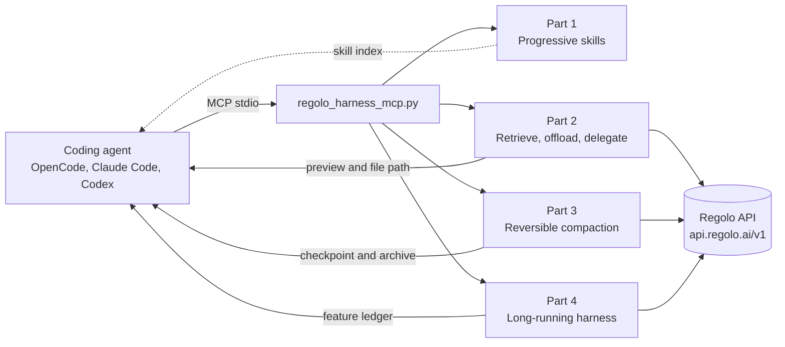

<div align="center">


# Context engineering for agents 101: a harness kit for OpenCode, Claude Code and Codex, measured on Regolo

[](https://www.python.org/)
[](https://docs.python.org/3/library/)
[](https://regolo.ai)
[](https://modelcontextprotocol.io)
[](../LICENSE)

> Four runnable Python modules and one MCP stdio server that put the context engineering patterns from the "Context engineering for agents 101" series into practice: progressive skill disclosure, retrieve-offload-delegate, reversible compaction with cache-safe memory, and a long-running harness with an independent evaluator. Every module calls the Regolo API at `https://api.regolo.ai/v1` and reports its own measured token savings.

**Reference series on regolo.ai:**
[Part 1: progressive disclosure](https://regolo.ai/context-engineering-for-agents-101-part-1-progressive-disclosure/) ·
[Part 2: retrieve, offload, delegate](https://regolo.ai/context-engineering-for-agents-101-part-2-retrieve-offload-delegate/) ·
[Part 3: compaction, prompt cache and memory](https://regolo.ai/context-engineering-for-agents-101-part-3-compaction-prompt-cache-memory/) ·
[Part 4: long-running agent harness](https://regolo.ai/context-engineering-for-agents-101-part-4-long-running-agent-harness/)

</div>

---

## Overview

A coding agent does not fail only because the model is weak. It often fails because its context window fills up with things it does not need right now: a full skills library loaded at start, a 30,000-character tool dump, a conversation that has grown past what the model can track, or a long task that runs out of room before it finishes.

This kit addresses those four problems, one module each. You can run each module on its own, or plug all of them into your daily coding agent through a single MCP server, `regolo_harness_mcp.py`. Each module ships with a `--self-test` mode that checks the behaviour and prints the token figures it measured.

The sections below show the architecture, the measured savings and how to connect the server to your agent.

---

## Architecture

The four pieces map onto the four problems above. The MCP server exposes the pieces as tools, so any agent that speaks MCP can call them.



Each piece writes its files under a `.harness/` folder next to its script. That folder is created at runtime and is excluded from git.

---

## Visual benchmarks

The figures below come from `measured_benchmark_results.json`, the output of the self-tests. They are measured on the Regolo API, so your numbers will move with the model routing and the content of your own skills and tool output.

### 1. Token savings per piece

| Piece | What it reduces | Before | After | Change |
|:---|:---|---:|---:|---:|
| **Part 1** | Skill index preloaded at start | 38,843 tokens | 327 tokens | **−99.2%** |
| **Part 1** | Tool response (detailed vs concise) | 1,140 tokens | 330 tokens | **−71.1%** |
| **Part 2** | Oversized tool dump offloaded to a file | 9,493 tokens | 318 tokens | **−96.7%** |
| **Part 2** | Main agent context after delegated reading | 9,493 tokens | 92 tokens | **−99.0%** |
| **Part 3** | History before and after compaction | 2,445 tokens | 195 tokens | **−92.0%** |
| **Part 3** | Prompt cache hit rate on turn 15 | 0.0% (naive injection) | 98.0% (cache-safe layout) | **98.0 points higher** |

### 2. Part 4 harness roles

| Role | Model | Prompt tokens | What it does |
|:---|:---|---:|:---|
| **Worker** | `qwen3.8-27b` | 269 | Starts every feature in a clean context and reads only `feature_list.json` |
| **Evaluator** | Served by `brick-v1-beta` (`qwen3.5-9b` in the measured run) | 284 | Runs the unit tests and an independent semantic audit before a feature can pass |

The worker and the evaluator never share a context window. That separation is what stops the agent from marking its own work as done.

---

## What is inside

### Part 1: progressive skill disclosure (`piece1_progressive_skills.py`)

Scans `~/.claude/skills` or `~/.agents/skills` and builds a one-line index per skill, about 18 tokens each, instead of loading every full `SKILL.md` at start. The full instructions load only when the agent asks for one skill by name. The module also formats tool responses in two modes, `detailed` and `concise`. The concise mode removes UUIDs and low-signal metadata.

### Part 2: retrieve, offload, delegate (`piece2_retrieve_offload_delegate.py`)

Intercepts any tool output longer than `max_chars` (1,200 by default). The full payload goes to `.harness/large_tool_results/<tool>_<hash>.txt`, and the agent receives only a path and a short head and tail preview. When a question about the file is needed, `delegate_chunk_analyst` sends the file to an isolated sub-agent routed through `brick-v1-beta`. Only the short answer returns to the main context. Retrieval uses `Qwen3-Embedding-8B` for embeddings and cosine similarity over the candidate chunks.

> The module docstring mentions reranking with `Qwen3-Reranker-4B`. The current code does not call a reranker, so the retrieval step is embedding-only.

### Part 3: reversible compaction and cache-safe memory (`piece3_compaction_and_cache_memory.py`)

When the history passes `threshold_tokens` (800 by default), the full transcript is archived verbatim to `.harness/conversation_history/<session_id>.md`. The older messages are then compacted through `brick-v1-beta`, and the last `keep_recent` turns (2 by default) stay verbatim. Compaction is reversible, because the archive keeps everything.

The module also orders the prompt so that static memory, such as `AGENTS.md`, sits in the cached prefix, and dynamic search results go at the tail. That ordering is what produces the cache hit rate in the table above.

### Part 4: long-running harness (`piece4_long_running_harness.py`)

Follows Anthropic's two-part pattern for long-running agents:

1. **Initializer.** Turns a product spec into `.harness/long_running_demo/feature_list.json`, where every feature starts with `"passes": false`, and into `progress.txt`.
2. **Worker.** Takes one feature at a time in a fresh context, implements it, and writes the result to the workspace.
3. **Evaluator.** Runs the tests and an independent audit. Only the evaluator can flip `"passes"` to `true`.

The loop repeats across sessions, so the agent can resume exactly where it stopped.

### MCP server (`regolo_harness_mcp.py`)

A stdio JSON-RPC server that exposes the pieces as four tools:

| Tool | Piece | What it does |
|:---|:---|:---|
| `load_skill_on_demand` | Part 1 | Loads the full instructions of one named skill |
| `offload_and_delegate` | Part 2 | Offloads a large payload to a file and optionally asks a sub-agent a question about it |
| `reversible_compact_history` | Part 3 | Archives the full session and returns a compact checkpoint |
| `init_feature_ledger` | Part 4 | Creates `feature_list.json` and `progress.txt` for a multi-session run |

---

## Project structure

```text
context-engineering-101/
├── README.md                              this file
├── piece1_progressive_skills.py           Part 1: skill index and concise responses
├── piece2_retrieve_offload_delegate.py    Part 2: retrieval, offloading and delegation
├── piece3_compaction_and_cache_memory.py  Part 3: reversible compaction and cache-safe memory
├── piece4_long_running_harness.py         Part 4: initializer, worker and evaluator
├── regolo_harness_mcp.py                  MCP stdio server that wraps the four pieces
├── measured_benchmark_results.json        Figures produced by the self-tests
└── .gitignore                             excludes .harness/ and __pycache__/
```

---

## Requirements

- Python 3.10 or later. The code uses only the standard library, so there is nothing to install with `pip`.
- A Regolo API key. Sign up at [regolo.ai/pricing](https://regolo.ai/pricing) for 30 days free, with a discount on the first 3 months.
- Optional: `~/.claude/skills` or `~/.agents/skills` if you want Part 1 to index your own skills.

---

## Quickstart

```bash
cd context-engineering-101
export REGOLO_API_KEY="your-regolo-key"

python3 piece1_progressive_skills.py --self-test
python3 piece2_retrieve_offload_delegate.py --self-test
python3 piece3_compaction_and_cache_memory.py --self-test
python3 piece4_long_running_harness.py --self-test
python3 regolo_harness_mcp.py --self-test
```

Without `REGOLO_API_KEY`, the self-tests still run their local checks. The live calls to the Regolo API are skipped.

---

## Connect the MCP server to your coding agent

Replace `/ABSOLUTE/PATH/TO` with the real path to this folder on your machine.

### OpenCode (`~/.config/opencode/opencode.json`)

```json
{
  "mcp": {
    "regolo-context-harness": {
      "type": "local",
      "command": ["python3", "/ABSOLUTE/PATH/TO/regolo_harness_mcp.py"],
      "environment": {
        "REGOLO_API_KEY": "{env:REGOLO_API_KEY}"
      }
    }
  }
}
```

### Claude Code

```bash
claude mcp add regolo-context-harness -e REGOLO_API_KEY="$REGOLO_API_KEY" -- python3 /ABSOLUTE/PATH/TO/regolo_harness_mcp.py
```

### Codex CLI (`~/.codex/config.toml`)

```toml
[mcp_servers.regolo_context_harness]
command = "python3"
args = ["/ABSOLUTE/PATH/TO/regolo_harness_mcp.py"]
env = { "REGOLO_API_KEY" = "your-regolo-key" }
```

Restart the agent after you edit its configuration, then check that the four tools appear in its tool list.

---

## Models used

| Model | Used by | Role |
|:---|:---|:---|
| `Qwen3-Embedding-8B` | Part 2 | Embeddings for retrieval |
| `brick-v1-beta` | Parts 2, 3 and 4 | Router. It picks the served model for the sub-agent, compaction and evaluator steps |
| `qwen3.8-27b` | Part 4 | Worker. The initializer can also use it, alongside `glm5.2` |

`brick-v1-beta` is Regolo's router. The response reports the model that actually served each call, so the figures above record the served model, not the name you sent.

---

## Troubleshooting

- **The self-test says the key is missing.** Export `REGOLO_API_KEY` in the same shell where you run the script, or pass it through the `environment` block of your agent.
- **The agent does not list the tools.** Check that the path in the configuration is absolute, and that `python3` points to Python 3.10 or later.
- **A `.harness/` folder appears in your repository.** It is created next to the script on the first run. It is listed in this folder's `.gitignore`, so git ignores it.

---

## License & third-party notices

MIT, like the rest of the `regolo-ai/tutorials` repository. See [LICENSE](../LICENSE).
