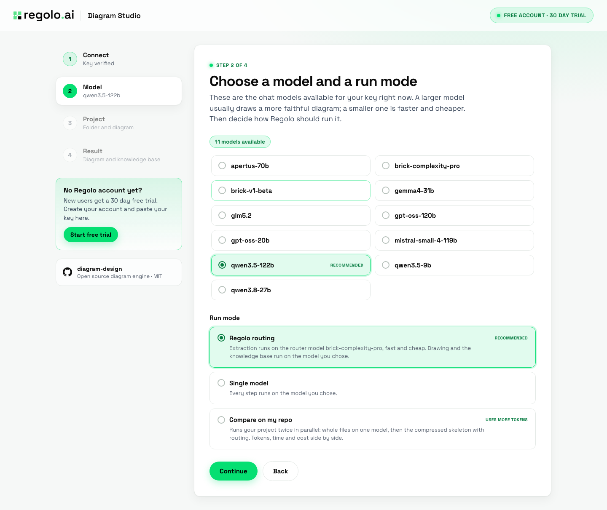
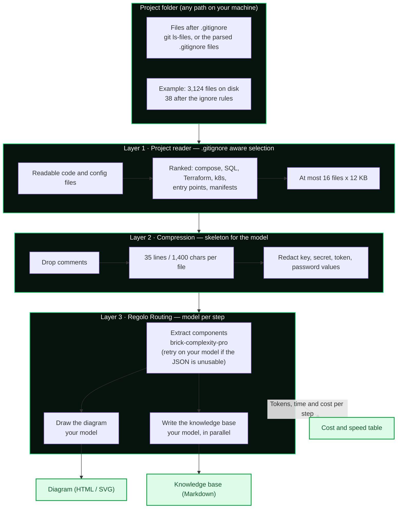
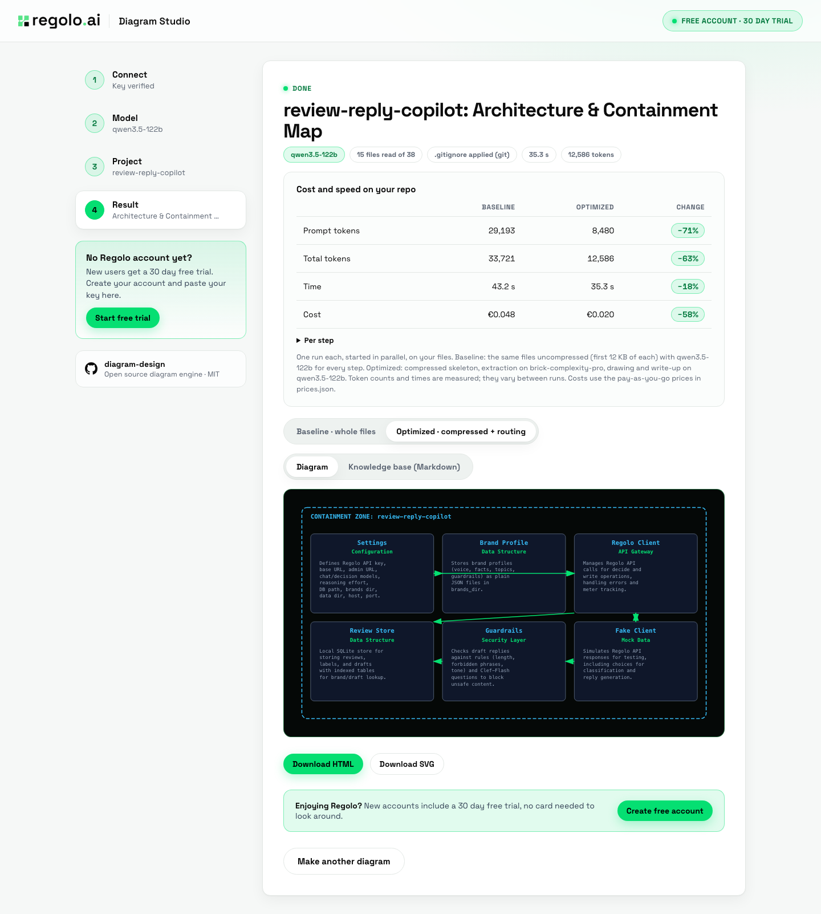
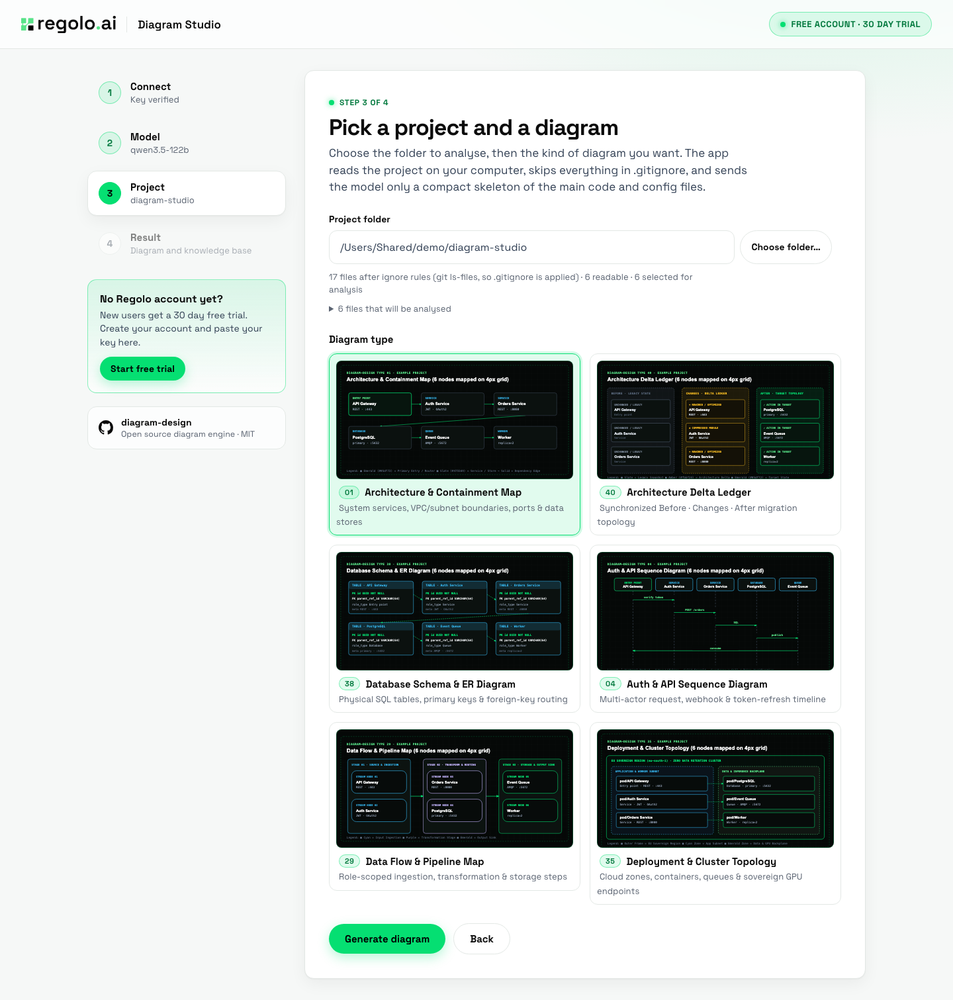

<div align="center">


# Regolo Diagram Studio: Project Folder to Architecture Diagram, Measured on Regolo

[](https://www.python.org/)
[](https://docs.python.org/3/library/)
[](https://regolo.ai)
[](#2-token-cost-and-time-impact-october-21-2026)
[](#automated-test-suite)

> A local web app that turns a project folder into an architecture diagram and a Markdown knowledge base for your AI agents, and measures what the model calls cost: `.gitignore` aware folder reading, input compression and Regolo model routing, compared side by side against sending whole files. Inspired by the diagram taxonomy and 4px-grid editorial concepts of the open source [diagram-design](https://github.com/cathrynlavery/diagram-design) project by Cathryn Lavery (MIT).

**Reference Article:** [Getting started with diagram-design and regolo: turn any codebase into interactive architecture maps](https://regolo.ai/getting-started-diagram-design-regolo-architecture-maps/)

**Video Tutorial:** [Watch on YouTube](https://youtu.be/PxJ01zoZkTw)

⭐ If you find this useful, star the repository on GitHub!

[Overview](#overview) • [Architecture](#architecture) • [Visual Benchmarks](#visual-benchmarks) • [Prerequisites](#prerequisites) • [Quickstart](#quickstart) • [Reproducing the Experiments](#reproducing-the-experiments) • [Project Structure](#project-structure) • [Configuration](#configuration)

</div>

---

## Overview

Coding agents and documentation tools pay the same tax twice: the project is re-sent to the model on every call, and every step goes to the same flagship model whatever its difficulty. Both costs are paid per call, so they compound.

This repository provides a **zero-dependency Python web app** (`diagram_wizard/server.py`) and an **offline benchmark** (`corpus.json` + `topology_extractor.py` + `benchmark.py`). The app reads a folder you choose, draws one of six diagram layouts, writes a knowledge base for your agents, and in **Compare mode** runs your project twice and shows tokens, time and cost side by side. The benchmark evaluates a 4-file microservice against **6 graded questions** (2 topology, 2 schema, 2 SVG) across four configurations:

1. **A. Baseline**: whole files, pinned to `qwen3.5-122b`.
2. **B. Local Compression Only**: topology compressors (YAML, SQL, route skeletons), still pinned to `qwen3.5-122b`.
3. **C. Regolo Routing Only**: whole files, but topology and schema questions go to `brick-complexity-pro`.
4. **D. Full Stack**: local compression and Regolo routing together.



> [!IMPORTANT]
> **Three findings worth acting on:**
> 1. **The Whole-Repository Tax:** on a real folder (`review-reply-copilot`, 15 files read of 38 after `.gitignore`), compressing the input cut prompt tokens by **70% to 71%** and cost by **54% to 58%** across three runs. The offline benchmark shows the same effect on a synthetic corpus: **32,578 to 5,621 total tokens (`−82.7%`)** with no accuracy loss (6/6 in A and D).
> 2. **The saving is tokens and cost, not total time:** the drawing step dominates the wall time and is the same in both runs, so total time moved between **+13% and −18%** across the three runs. The router wins on the extraction step alone: **7.7 s to 2.8 s** in run 3.
> 3. **The Cheap-Router Truncation Trap:** routing without compression failed **1 of 6** benchmark questions (`83.3%`), and in the app `brick-complexity-pro` was more verbose than expected: its JSON was cut off at the first 700 token limit, and even with a stricter prompt and a 900 token limit it failed on whole files in 3 of 3 direct calls (it worked 3 of 3 on the compressed skeleton). A router that never falls back is a silent correctness bug: the app retries the step on your model, counts both calls in the cost, and says so.

---

## Architecture



### Layer 1 — Project reader: `.gitignore` aware selection

The server reads the folder itself, because a browser cannot reveal a real path and its folder picker uploads every file. In a git repository the list comes from `git ls-files --cached --others --exclude-standard`, which includes nested and global ignore rules. Outside git, the `.gitignore` files are parsed (negation, `**`, anchored and directory-only rules). `node_modules`, `.git`, build output, dot files such as `.env`, lock files and names containing secret, credential or private are always skipped. At most 16 files are kept, 12 KB of each, ranked so compose files, SQL and schema files, Terraform and Kubernetes manifests, entry points and manifests come first.

### Layer 2 — Compression: a skeleton for the model

Comments are dropped and each file is cut to 35 lines and 1,400 characters. Values on lines with key, secret, token or password in the name are replaced by `<redacted>`, also in the uncompressed baseline. The offline benchmark uses the stricter topology compressors in `topology_extractor.py`: a YAML stripper that keeps services, ports and `depends_on`, a SQL extractor that keeps tables, primary and foreign keys, and a route skeleton that keeps decorators and upstream calls.

### Layer 3 — Regolo Routing: model per step

| Step | Model | `max_tokens` |
|:---|:---|:---:|
| Extract components (JSON, at most 6 nodes and 8 edges) | `brick-complexity-pro` in routed mode, your model otherwise | 900 |
| Draw the diagram (inline SVG on a 4px grid) | your model | 2800 |
| Write the knowledge base (Markdown) | your model, in parallel with the drawing | 1600 |

All calls use `reasoning_effort="none"`, and are retried without it for models that reject the parameter. The six layouts follow diagram types of the open source [diagram-design](https://github.com/cathrynlavery/diagram-design) project: architecture and containment, architecture delta, database schema, sequence, data flow and deployment. Regolo Diagram Studio reimplements them with its own builders and prompts; it does not run the diagram-design skill.

---

## Visual Benchmarks

### 1. Layer-by-Layer Input Compaction

The folder funnel, measured on a copy of the `review-reply-copilot` folder with its virtual environment:

```text
Files in the project folder (copy of review-reply-copilot, with its .venv)
──────────────────────────────────────────────────────────────────────────────
On disk            ████████████████████████████████████████  3,124
After .gitignore   █                                         38
Read by the model  █                                         15
```

Prompt tokens per step in the app, run 3 (whole files against compressed skeleton and router):

| Step | Whole files | Compressed | Change |
|:---|---:|---:|---:|
| Extract components | 17,298 | 5,069 | **−70.7%** |
| Draw the diagram (input is the topology) | 590 | 595 | +0.8% |
| Write the knowledge base | 11,281 | 2,880 | **−74.5%** |

Per-file compaction in the offline benchmark (4-file microservice, configuration D, question t5 where all four files are sent):

| File | Compressor | Raw | Compressed | Reduction |
|:---|:---|---:|---:|---:|
| `infra/docker-compose.yml` | `yaml_topology_stripper` | 5,312 | 596 | **−88.8%** |
| `db/schema.sql` | `sql_fk_extractor` | 5,304 | 507 | **−90.4%** |
| `src/gateway_routes.py` | `ast_route_skeleton` | 4,553 | 403 | **−91.1%** |
| `src/worker_consumers.py` | `ast_route_skeleton` | 4,375 | 226 | **−94.8%** |

```text
Prompt size per question (characters, 4-file repository)
──────────────────────────────────────────────────────────────────────────────
Raw repository       ████████████████████████████████████████  19,544
Compressed skeleton  ████                                      1,732  −91.1% vs raw
```

### 2. Token, Cost and Time Impact (October 21, 2026)

Measured in the app, **Compare on my repo** mode: one run each side, three separate runs, on the folder of [review-reply-copilot](../review-reply-copilot), with `qwen3.5-122b`, the Architecture and Containment Map.

| Run | Prompt tokens, whole files to compressed | Total tokens | Time | Cost |
|:---:|:---|:---|:---|:---|
| 1 | 29,223 to 8,698 (**−70.2%**) | 33,306 to 13,199 (−60.4%) | 37.1 s to 41.7 s (+13%) | 0.046 to 0.021 EUR (−54%) |
| 2 | 29,193 to 8,480 (**−71.0%**) | 33,721 to 12,586 (−62.7%) | 43.2 s to 35.3 s (−18%) | 0.048 to 0.020 EUR (−58%) |
| 3 | 29,169 to 8,544 (**−70.7%**) | 33,807 to 12,956 (−61.7%) | 39.7 s to 37.6 s (−5%) | 0.049 to 0.021 EUR (−56%) |



Per step, run 3:

| Step | Baseline: model, tokens in / out, time, cost | Optimized: model, tokens in / out, time, cost |
|:---|:---|:---|
| Extract components | `qwen3.5-122b`, 17,298 / 493, 7.7 s, €0.019 | `brick-complexity-pro`, 5,069 / 329, 2.8 s, €0.0006 |
| Draw the diagram | `qwen3.5-122b`, 590 / 2,545, 32.1 s, €0.011 | `qwen3.5-122b`, 595 / 2,679, 34.9 s, €0.012 |
| Write the knowledge base | `qwen3.5-122b`, 11,281 / 1,600, 21.6 s, €0.018 | `qwen3.5-122b`, 2,880 / 1,404, 20.2 s, €0.0088 |

```text
Prompt tokens, run 3 (whole files vs compressed + routing)
──────────────────────────────────────────────────────────────────────────────
Baseline   ████████████████████████████████████████  29,169
Optimized  ████████████                              8,544  −70.7%
```

```text
Cost, run 3 (EUR)
──────────────────────────────────────────────────────────────────────────────
Baseline   ████████████████████████████████████████  0.049 EUR
Optimized  █████████████████                         0.021 EUR  −56%
```

```text
Time, run 3 (seconds)
──────────────────────────────────────────────────────────────────────────────
Baseline   ████████████████████████████████████████  39.7 s
Optimized  ██████████████████████████████████████    37.6 s  −5%
```

> [!NOTE]
> **Reading the time column.** The baseline and the optimized run start together, and the knowledge base is written while the diagram is drawn, so the wall time is the extraction step plus the longer of drawing and writing. The drawing takes about 32 to 35 s in both runs, which sets the total. The extraction step is about 2.8x faster on the router, but it is a small share of the total, so this mode is a cost result and not a speed result.

The same effect, offline, on the synthetic corpus (October 20, 2026, one run, 6 questions, all run concurrently, measured against `https://api.regolo.ai/v1/chat/completions`):

| Configuration | Accuracy | Prompt tokens | Completion tokens | Total tokens | Latency `p50` | Wall time | Cost / 1,000 sessions |
|:---|:---:|---:|---:|---:|---:|---:|:---|
| **A. Baseline** (whole files + `qwen3.5-122b`) | **100.0% (6/6)** | 27,508 | 5,070 | 32,578 | 7.88 s | 8.09 s | $105.72 (Private) · $60.82 (Z.ai) · €48.8 (Regolo PAYG) · **€2.12** (Regolo Core / **€0.64** promo) |
| **B. Compression only** (compressed skeleton + `qwen3.5-122b`) | 100.0% (6/6) | 3,394 (**−87.7%**) | 5,400 (+6.5%) | 8,794 (−73.0%) | 7.88 s | 7.88 s | $60.79 (Private) · $28.51 (Z.ai) · €26.07 (Regolo PAYG) · **€0.57** (Regolo Core / **€0.17** promo) |
| **C. Routing only** (whole files + routing) | 83.3% (5/6) | 27,516 (+0.0%) | 2,017 (−60.2%) | 29,533 (−9.3%) | 1.01 s (7.8× faster) | 6.29 s | $75.2 (Private) · $47.4 (Z.ai) · €18.68 (Regolo PAYG) · **€1.92** (Regolo Core / **€0.58** promo) |
| **D. Full stack** (compression + routing) | 100.0% (6/6) | 3,402 (**−87.6%**) | 2,219 (−56.2%) | 5,621 (−82.7%) | 1.92 s (4.1× faster) | 5.51 s | $28.99 (Private) · $14.53 (Z.ai) · €9.36 (Regolo PAYG) · **€0.37** (Regolo Core / **€0.11** promo) |

```text
Prompt tokens per session (6 questions)
──────────────────────────────────────────────────────────────────────────────
A. Baseline          ████████████████████████████████████████  27,508
B. Compression only  █████                                     3,394  −87.7%
C. Routing only      ████████████████████████████████████████  27,516  +0.0%
D. Full stack        █████                                     3,402  −87.6%
```

```text
Query latency p50 (seconds)
──────────────────────────────────────────────────────────────────────────────
A. Baseline          ████████████████████████████████████████  7.88 s
B. Compression only  ████████████████████████████████████████  7.88 s
C. Routing only      █████                                     1.01 s  7.8x faster
D. Full stack        ██████████                                1.92 s  4.1x faster
```

```text
Cost per 1,000 sessions, Regolo PAYG (EUR)
──────────────────────────────────────────────────────────────────────────────
A. Baseline          ████████████████████████████████████████  48.8 EUR
B. Compression only  █████████████████████                     26.07 EUR  −46.6%
C. Routing only      ███████████████                           18.68 EUR  −61.7%
D. Full stack        ████████                                  9.36 EUR  −80.8%
```

```text
Accuracy (6 graded questions)
──────────────────────────────────────────────────────────────────────────────
A. Baseline          ████████████████████████████████████████  100.0%  6/6
B. Compression only  ████████████████████████████████████████  100.0%  6/6
C. Routing only      █████████████████████████████████         83.3%  5/6  - t3 failed
D. Full stack        ████████████████████████████████████████  100.0%  6/6
```

> [!CAUTION]
> **The t3 failure belongs to routing without compression.** In configuration C, `brick-complexity-pro` answered the foreign key question (t3) with 57 tokens and failed it, while the same question passed in A, B and D. This is one run and one question, so it shows that a router needs a fallback, not how often it fails. In the app the fallback is automatic: if the router's component list is unusable, the extraction is repeated on your model and both calls are counted in the cost.

### 3. Cost Model

Prices verified against <https://regolo.ai/pricing/> on October 21, 2026:

- **Regolo Core Plan:** €39.00/month for up to 600M tokens (`€0.065 / 1M tokens`), or **€11.70/month** (`€0.0195 / 1M tokens`) with the 70% discount for the first 3 months.
- **Regolo Pay-As-You-Go:** `brick-complexity-pro` (`€0.10 / €0.40` per 1M in/out), `qwen3.5-122b` (`€1.00 / €4.20` per 1M in/out).
- **External APIs, as assumed in `benchmark.py` and not verified:** Z.ai Direct `GLM-5.3` (`$1.40 / $4.40`), Private Workhorse API (`$2.00 / $10.00`).

The app's cost table uses the pay-as-you-go prices in `diagram_wizard/prices.json`. Costs are computed from the tokens reported by the API, not from an invoice.

```text
Cost per 1,000 sessions, Regolo Core 600M tokens (EUR)
──────────────────────────────────────────────────────────────────────────────
A. Baseline          ████████████████████████████████████████  2.12 EUR
B. Compression only  ███████████                               0.57 EUR  −73.1%
C. Routing only      ████████████████████████████████████      1.92 EUR  −9.4%
D. Full stack        ███████                                   0.37 EUR  −82.5%
```

---

## Prerequisites

- **Python:** `3.10` or newer (zero external third-party packages required; only Python's standard library is used).
- **Regolo API Key:** required for every model call. [Create a free trial account on Regolo](https://regolo.ai/pricing): new users get 30 days of free trial, see the page for the current terms.
- **Optional:** `git` for exact `.gitignore` handling (otherwise the `.gitignore` files are parsed), `npx` to install the diagram-design skill from the terminal version, and `osascript` (macOS) or `zenity` (Linux) for the native folder dialog.
- **No GPU, no Docker, no `pip install`.**

---

## Quickstart

### 1. Clone the Repository

```bash
git clone https://github.com/regolo-ai/tutorials.git
cd tutorials/diagram-studio
```

### 2. Verify the Local Pipeline (No API Calls Required)

```bash
python3 -m unittest diagram_wizard/test_server.py
python3 test_benchmark.py
```

Expected output:

```text
Ran 12 tests in 0.043s

OK
All diagram topology compression, FK extraction, and routing assertions passed.
```

### 3. Start the App

```bash
python3 diagram_wizard/server.py      # opens http://127.0.0.1:8200
```

Paste your Regolo API key in step 1 (it stays in the browser tab and is never written to disk), pick a model and a run mode in step 2, then choose a folder and a diagram type in step 3 and click **Generate diagram**.



The result gives you the diagram as a standalone HTML page or an SVG, the cost and speed table, and a Markdown knowledge base with a Mermaid version of the diagram. A terminal version with the same six layouts is `python3 regolo_diagram_tui.py`.

### 4. Run the Offline Benchmark (Uses Tokens)

```bash
export REGOLO_API_KEY="your-regolo-api-key"
python3 benchmark.py
```

---

## Reproducing the Experiments

### Automated Test Suite

The app tests are fully offline and deterministic: Regolo calls are replaced by a fake client. They assert that the cost is computed from the price table (and is `n/a` for an unpriced model), that routed mode sends the extraction to the router and the other steps to your model, that an unusable router answer is retried on your model, that the baseline sends more than twice the prompt tokens of the optimized run, that secret values are redacted both in the compressed and the uncompressed text, and that the `.gitignore` rules (negation, `**`, anchored and directory-only patterns) select the same files in git mode and in the parser fallback. `test_benchmark.py` asserts the YAML, SQL and route compressors and the routing table.

```bash
python3 -m unittest diagram_wizard/test_server.py
python3 test_benchmark.py
```

### Reproduce the Compare Table

Start the app, choose **Compare on my repo** in step 2, point it at a project folder, and generate. The table shows prompt tokens, total tokens, time and cost for the baseline and the optimized run, and **Per step** shows where the tokens go. Token counts and times are measured, and they vary from run to run: expect your numbers to differ from the table above.

### Run the Offline Benchmark

```bash
python3 benchmark.py
```

The runner executes the four configurations sequentially and writes the complete JSON output to `benchmark_results.json`:

```text
Running A. Baseline (Uncompressed + Pinned qwen3.5-122b)...
  -> Accuracy: 100.0% | Prompt: 27508 | Completion: 5070 | Total: 32578 | p50: 7.88s | Regolo PAYG/1k: €48.8 | Regolo Core/1k: €2.12 (€0.64 promo)
Running B. Local Topology Compression Only...
  -> Accuracy: 100.0% | Prompt: 3394 | Completion: 5400 | Total: 8794 | p50: 7.88s | Regolo PAYG/1k: €26.07 | Regolo Core/1k: €0.57 (€0.17 promo)
Running C. Regolo Brick Complexity Pro Routing Only...
  -> Accuracy: 83.3% | Prompt: 27516 | Completion: 2017 | Total: 29533 | p50: 1.01s | Regolo PAYG/1k: €18.68 | Regolo Core/1k: €1.92 (€0.58 promo)
Running D. Full Stack (Local Topology Compression + Regolo Brick Pro)...
  -> Accuracy: 100.0% | Prompt: 3402 | Completion: 2219 | Total: 5621 | p50: 1.92s | Regolo PAYG/1k: €9.36 | Regolo Core/1k: €0.37 (€0.11 promo)

  === EXPLICIT 3-LAYER DIAGRAM PIPELINE LOGS (Configuration D, first question shown) ===
  [t1 · topology]
    [Layer 1 · file selector] 4 repo files -> 3 selected (14240 chars): ['infra/docker-compose.yml', 'src/gateway_routes.py', 'src/worker_consumers.py']
    [Layer 2 · topology compressor] 14240 chars -> 1342 chars (-90.6% in Layer 2 | -93.1% vs raw repo):
      ├─ infra/docker-compose.yml [yaml_topology_stripper]: 5312 -> 596 chars (-88.8%) · stripped 74 comment/logging lines; kept service, port & dependency edges
      ├─ src/gateway_routes.py [ast_route_skeleton]: 4553 -> 403 chars (-91.1%) · stripped 63 docstring/comment lines; kept route signatures & service calls
      ├─ src/worker_consumers.py [ast_route_skeleton]: 4375 -> 226 chars (-94.8%) · stripped 62 docstring/comment lines; kept route signatures & service calls
    [Layer 3 · regolo routing] model=brick-complexity-pro reasoning_effort=none -> in=539 tok, out=81 tok, latency=0.811s, pass=True

Saved benchmark_results.json successfully.
```

---

## Project Structure

```text
diagram-studio/
├── README.md                      # Documentation, visual benchmarks & reproduction guide
├── requirements.txt               # No packages: standard library only (lists Python and the optional tools)
├── .env.example                   # Optional key file for the terminal version and the benchmark (.env is git-ignored)
├── .gitignore                     # Keeps .env, output/ and caches out of git
├── diagram_wizard/
│   ├── server.py                  # Local web server, the pipeline and the .gitignore aware project reader
│   ├── static/                    # The interface (plain HTML, CSS and JavaScript, Regolo logo, font)
│   ├── prices.json                # Price per million tokens for the cost table
│   └── test_server.py             # 12 offline tests with a fake Regolo client
├── regolo_diagram_tui.py          # Terminal version, the six layout builders and the prompts
├── topology_extractor.py          # Local YAML, SQL and route compressors used by the benchmark
├── benchmark.py                   # Offline benchmark: 4 configurations vs the Regolo API (needs a key)
├── corpus.json                    # 4-file microservice + 6 graded questions
├── test_benchmark.py              # Offline unit tests: compression and routing
├── benchmark_results.json         # Raw token counts, latencies, accuracy and cost projections (Oct 20, 2026 run)
└── docs/
    ├── how-it-works.md            # Pipeline, run modes, folder reading and privacy in detail
    └── img/                       # Screenshots used in this README
```

---

## Configuration

| Environment Variable / Setting | Default | Description |
|:---|:---:|:---|
| `REGOLO_API_KEY` | *(Required for `benchmark.py` and the terminal version)* | Authentication key for Regolo's API. The web app does not read it: you paste the key in the browser. |
| `REGOLO_BASE_URL` | `https://api.regolo.ai/v1` | Base endpoint, read by the terminal version. The web app uses the default. |
| `REGOLO_SVG_MODEL` | `qwen3.5-122b` | Model used by the terminal version. |
| `--port`, `--no-open` | `8200`, off | Port of the local server, and whether to skip opening the browser. |
| `diagram_wizard/prices.json` | `brick-complexity-pro`, `qwen3.5-122b` | Price per million tokens for the cost table. Edit it when prices change; a model without a price shows tokens only. |

Copy `.env.example` to `.env` if you want to keep the key for the terminal version or the benchmark. `.env` is git-ignored.

Tunable constants live at the top of `diagram_wizard/server.py`: `MAX_FILES` (files sent, default `16`), `MAX_READ` (characters read per file, `12000`), `MAX_SIZE` (largest file read, `400000` bytes), `ROUTER_MODEL` and `PREFERRED_MODEL`, and the `max_tokens` budget of each step (`900`, `2800`, `1600`).

### Limits you should know

- Three runs on one project is a measurement, not a guarantee. The benchmark corpus is synthetic, with 6 questions and one run.
- The baseline is the same files uncompressed (the first 12 KB of each), not the whole repository.
- A diagram drawn by a model can be wrong or untidy, and accuracy is not measured on real projects. Check it against your code before you rely on it, and read the knowledge base the same way.
- Redaction is pattern based (lines with key, secret, token or password in the name). It is not a guarantee, so do not point the app at a folder that holds secrets in code. Only the skeleton of the selected files is sent to the model on Regolo; see Regolo's documentation for its data handling terms.
- The native folder dialog needs macOS (`osascript`) or Linux with `zenity`, otherwise paste the path. Windows is untested.

---

## License & Third-Party Notices

MIT, like the rest of the `regolo-ai/tutorials` repository. Fonts: Space Grotesk (SIL Open Font License). The Regolo name and logo belong to Regolo.

### Third-Party Notices

This repository is an independent Python implementation (web app, terminal TUI, and benchmark runner) and does not bundle or redistribute code from `diagram-design`. Its six diagram type categories and 4px-grid editorial layout concepts are inspired by [cathrynlavery/diagram-design](https://github.com/cathrynlavery/diagram-design) (and the terminal TUI optionally invokes `npx skills add cathrynlavery/diagram-design` from the official upstream repository):

- **diagram-design** — Copyright (c) 2025 Cathryn Lavery ([littlemight.com](https://littlemight.com)), licensed under the [MIT License](https://github.com/cathrynlavery/diagram-design/blob/main/LICENSE).
