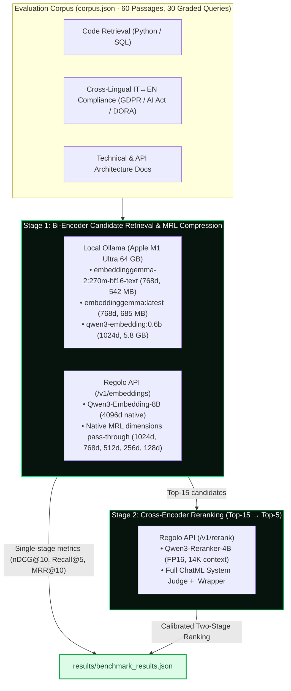

<div align="center">


# EmbeddingGemma 2 vs Qwen3-Embedding (0.6B & 8B) + Reranker-4B Benchmarks

[](https://www.python.org/)
[](https://ollama.com/)
[](https://regolo.ai)
[](https://regolo.ai)
[](#3-matryoshka-mrl-compression-curve-4096d-to-128d)
[](#automated-test-suite)

> Reproducible retrieval quality, Matryoshka Representation Learning (MRL) vector compression, local unified-memory profiling, and two-stage cross-encoder reranking across local Apple Silicon and Regolo's sovereign European API.

**Reference Article:** [EmbeddingGemma 2 vs Qwen3-Embedding (0.6B & 8B): Code Retrieval, Matryoshka Compression, and Reranking Benchmarks](https://regolo.ai/embeddinggemma-2-vs-qwen3-embedding-benchmarks/)

⭐ If you find this benchmark useful, star the repository on GitHub!

[Overview](#overview) • [Architecture](#architecture) • [Visual Benchmarks](#visual-benchmarks) • [Prerequisites](#prerequisites) • [Quickstart](#quickstart) • [Reproducing the Experiments](#reproducing-the-experiments) • [Project Structure](#project-structure) • [Configuration](#configuration)

</div>

---

## Overview

When evaluating open-weight embedding models for production Retrieval-Augmented Generation (RAG) and code search, public leaderboards only tell half the story. In Google's October 2026 **EmbeddingGemma 2** model card, external open-weight baselines (`Qwen3-Embedding-0.6B` and `Qwen3-Embedding-8B`) were omitted from the main comparison table.

This repository provides a **zero-dependency Python benchmark suite** (`corpus.json` + `benchmark.py`) that evaluates **60 curated passages** (30 primary answers + 30 near-miss hard negatives) and **30 graded-relevance queries** across three enterprise workloads:

1. **Code Retrieval (20 implementations, 10 queries):** Python and SQL implementations (Redis Lua token buckets, async full-jitter backoff, AST function chunkers, `pgvector` HNSW queries, constant-time HMAC-SHA256 verification) paired with syntactically similar distractors.
2. **Multilingual & Cross-Lingual IT↔EN Compliance (20 passages, 10 queries):** GDPR Article 28 Zero Data Retention, EU AI Act Article 50 watermarking, DORA ICT exit strategies, Italian Garante Privacy 21-day email metadata rules, FSE 2.0 hospital pseudonymization, and US CLOUD Act exposure.
3. **Technical & API Architecture Docs (20 passages, 10 queries):** KV cache mechanics, Matryoshka truncation, bi-encoder vs cross-encoder attention, 1-bit binary quantization failure modes, and MoE active-parameter memory footprints.

> [!IMPORTANT]
> **Three production traps uncovered by this suite:**
> 1. **The 5.8 GB Ollama KV-Cache Trap:** Although `qwen3-embedding:0.6b` is a 639 MB download, Ollama pre-allocates its full 32,768-token context window in unified memory at startup (`5.8 GB`). By contrast, `embeddinggemma-2:270m-bf16-text` (8,192-token context on MLX) uses **`542 MB`** (`10.7x` less memory).
> 2. **The Ollama `0.40.4+` Version Gate:** Because EmbeddingGemma 2 uses the Gemma 4 architecture, Ollama `0.21.x` fails to pull the manifest with `HTTP 412`.
> 3. **The `Qwen3-Reranker-4B` ChatML Trap:** Calling `/v1/rerank` with only `<Instruct>`, `<Query>`, and `<Document>` tags drops two-stage `nDCG@10` to **`77.98%`**. Wrapping the prompt in Qwen's full ChatML system judge header and empty `<think>\n\n</think>` block restores calibrated probabilities (`0.9995` vs `0.0000`) and lifts `nDCG@10` to **`96.84%`** (`+18.86` points, with `100%` Code `Recall@5`).

---

## Architecture



---

## Visual Benchmarks

### 1. Published MTEB & Multimodal Baselines vs What Google Omitted

| Specification / Benchmark | EmbeddingGemma 2 | EmbeddingGemma 1 | Qwen3-Embedding-0.6B | Qwen3-Embedding-8B (Regolo API) |
|:---|:---:|:---:|:---:|:---:|
| **Base Architecture** | Gemma 4 (modular) | Gemma 3 (text) | Qwen3 decoder | Qwen3 decoder |
| **Active Parameters** | **270M text** / 740M full | 308M text | 595M text | 7.57B text |
| **Context Window** | 8,192 tokens | 2,048 tokens | **32,768 tokens** | **32,768 tokens** |
| **Native Dimension (MRL)** | 768 (512, 256, 128) | 768 (512, 256, 128) | 1,024 (32..1024) | 4,096 (32..4096 on Regolo) |
| **MTEB Multilingual v2** | 61.36 | 61.15 | **64.33** | **70.58** |
| **MTEB Code v1 (nDCG@10)** | **78.68** | 68.76 | 75.41 | **80.68** |
| **MMEB v2 VisDoc (nDCG@5)** | **67.84** | Not supported | Not supported | Not supported |

```text
MTEB Multilingual v2 (Published Mean Task Score)
────────────────────────────────────────────────────────────────────────────────
Qwen3-Embedding-8B (Regolo API)  ███████████████████████████████████▌  70.58
Qwen3-Embedding-0.6B             ████████████████████████████████▏     64.33
EmbeddingGemma 2 (270M Text)     ██████████████████████████████▋       61.36
EmbeddingGemma 1 (308M Text)     ██████████████████████████████▌       61.15

MTEB Code v1 (Published nDCG@10)
────────────────────────────────────────────────────────────────────────────────
Qwen3-Embedding-8B (Regolo API)  ████████████████████████████████████████▎ 80.68
EmbeddingGemma 2 (270M Text)     ███████████████████████████████████████▎  78.68 (+9.92 vs v1)
Qwen3-Embedding-0.6B             █████████████████████████████████████▋    75.41
EmbeddingGemma 1 (308M Text)     ██████████████████████████████████▍       68.76
```

---

### 2. Measured Retrieval Quality, Latency & Local Unified Memory (Oct 15, 2026)

Measured on **Apple M1 Ultra (64 GB unified memory, macOS arm64, Ollama `0.40.4`)** and **Regolo API (`https://api.regolo.ai/v1`)**:

| Model & Runtime | Native Dim | Local GPU RAM (`ollama ps`) | Query Latency `p50` / `p95` | Overall `nDCG@10` | Overall `Recall@5` | Code `nDCG@10` | Multilingual IT↔EN `nDCG@10` | Tech Docs `nDCG@10` |
|:---|:---:|:---:|:---:|:---:|:---:|:---:|:---:|:---:|
| **EmbeddingGemma 2** (`270m-bf16-text`, MLX) | 768 | **542 MB** (8K ctx) | **23.9 ms** / 25.8 ms | 95.93% | 92.22% | 96.51% | 96.08% | 95.21% |
| **EmbeddingGemma 1** (`308m`, llama.cpp) | 768 | 685 MB (2K ctx) | 23.7 ms / 26.6 ms | 97.17% | 92.22% | 99.09% | 97.51% | 94.91% |
| **Qwen3-Embedding-0.6B** (Local llama.cpp) | 1024 | 5.8 GB (32K ctx) | 30.1 ms / 43.0 ms | 97.76% | 95.00% | 97.90% | 97.51% | **97.89%** |
| **Qwen3-Embedding-8B** (Regolo API) | 4096 | **0 MB local** | 300.2 ms / 415.7 ms | **98.27%** | **98.33%** | **99.64%** | **97.90%** | 97.27% |

```text
Local Unified GPU Memory in Ollama 0.40.4 (Apple M1 Ultra)
────────────────────────────────────────────────────────────────────────────────
embeddinggemma-2:270m (8K ctx)   ████                                   542 MB
embeddinggemma:latest (2K ctx)   █████                                  685 MB
qwen3-embedding:0.6b (32K ctx)   █████████████████████████████████████  5.8 GB (10.7x more)
```

**Asymmetric Instruction Prefix Penalty (Prefixed vs Raw Unprefixed Queries):**
- `EmbeddingGemma 2`: `Recall@5` drops from **92.22% → 87.22% (`-5.00 pts`)** when omitting `task: ... | query:`.
- `Qwen3-Embedding-0.6B`: `Recall@5` drops from **95.00% → 92.22% (`-2.78 pts`)** when omitting `Instruct: ...\nQuery:`.
- `Qwen3-Embedding-8B`: `Recall@5` drops from **98.33% → 93.89% (`-4.44 pts`)**, and Technical Docs `nDCG@10` drops from **97.27% → 94.03%**.

---

### 3. Matryoshka (MRL) Compression Curve: `4096d` to `128d`

Passing `"dimensions": 512` or `"dimensions": 256` to `Qwen3-Embedding-8B` on Regolo's `/v1/embeddings` API slices and L2-renormalizes the vector server-side:

| Vector Dimension | Raw Float32 RAM (10M Chunks) | Int8 Quantized RAM (10M Chunks) | EmbeddingGemma 2 `nDCG@10` (`Recall@5`) | Qwen3-Embedding-0.6B `nDCG@10` (`Recall@5`) | Qwen3-Embedding-8B Regolo API `nDCG@10` (`Recall@5`) |
|:---|:---:|:---:|:---:|:---:|:---:|
| **4096d** (8B native) | 152.59 GB | 38.15 GB | N/A | N/A | **98.27%** (98.33%) |
| **1024d** (0.6B native / 8B MRL) | 38.15 GB | 9.54 GB | N/A | 97.76% (95.00%) | 97.70% (96.67%) |
| **768d** (Gemma native / Qwen MRL) | 28.61 GB | 7.15 GB | 95.93% (92.22%) | 98.10% (95.00%) | 97.33% (96.67%) |
| **512d** (MRL sweet spot) | **19.07 GB** | **4.77 GB** | 95.92% (90.56%) | **98.14%** (93.33%) | **97.52%** (95.00%) |
| **256d** (MRL compact) | **9.54 GB** | **2.38 GB** | **95.95%** (87.22%) | 97.54% (95.00%) | **97.60%** (95.00%) |
| **128d** (MRL floor) | 4.77 GB | 1.19 GB | 94.49% (85.56%) | 96.80% (93.33%) | 97.27% (93.33%) |

```text
Vector Index RAM for 10 Million Chunks (Float32) vs Qwen3-8B nDCG@10
────────────────────────────────────────────────────────────────────────────────
4096d Native   ████████████████████████████████████████  152.59 GB  (98.27% nDCG@10)
1024d MRL      ██████████                                 38.15 GB  (97.70% nDCG@10)
 768d MRL      ███████▌                                   28.61 GB  (97.33% nDCG@10)
 512d MRL      █████                                      19.07 GB  (97.52% nDCG@10 -> 8x RAM cut)
 256d MRL      ██▌                                         9.54 GB  (97.60% nDCG@10 -> 16x RAM cut)
```

---

### 4. Two-Stage Retrieval (`EmbeddingGemma 2` + `Qwen3-Reranker-4B`)

Reranking the top 15 candidates from local `EmbeddingGemma 2` using `Qwen3-Reranker-4B` on Regolo's `/v1/rerank` endpoint (`€0.01/query`):

| Pipeline Configuration | Overall `nDCG@10` | Overall `Recall@5` | Code `nDCG@10` (`Recall@5`) | Multilingual IT↔EN `nDCG@10` | Rerank Latency `p50` |
|:---|:---:|:---:|:---:|:---:|:---:|
| Stage 1 only: **EmbeddingGemma 2 (270M)** | 95.93% | 92.22% | 96.51% (95.0%) | 96.08% | 0 ms (23.9 ms embed) |
| Stage 1 + 2: **Gemma 2 + Qwen3-Reranker-4B** *(tags only, no ChatML)* | 77.98% | 69.44% | 80.36% (80.0%) | 82.61% | 345.5 ms |
| Stage 1 + 2: **Gemma 2 + Qwen3-Reranker-4B *(with ChatML wrapper)*** | **96.84%** | **95.56%** | **98.42% (100.0%)** | **98.46%** | 332.2 ms |
| Stage 1 + 2: **Qwen3-0.6B + Qwen3-Reranker-4B *(with ChatML wrapper)*** | **96.84%** | **95.56%** | **98.42% (100.0%)** | 97.54% | 324.0 ms |
| Single-stage reference: **Qwen3-Embedding-8B** (Regolo API, 4096d) | **98.27%** | **98.33%** | **99.64% (100.0%)** | 97.90% | 300.2 ms (embed only) |

```text
Two-Stage Retrieval Impact (EmbeddingGemma 2 Top-15 -> Qwen3-Reranker-4B)
────────────────────────────────────────────────────────────────────────────────
Tags Only (No ChatML)            ███████████████████████████████▏       77.98% nDCG@10
Stage 1 Only (Gemma 2 270M)      ██████████████████████████████████████▍95.93% nDCG@10
Gemma 2 + Reranker-4B (ChatML)   ██████████████████████████████████████▊96.84% nDCG@10 (100% Code R@5)
```

---

## Prerequisites

- **Python:** `3.10` or newer (zero external third-party packages required to run `benchmark.py`; only Python's standard library is used).
- **Ollama:** Version `0.40.4` or newer for local `EmbeddingGemma 2` (Gemma 4 architecture) and `Qwen3-Embedding-0.6B`.
- **Regolo API Key:** Required for `Qwen3-Embedding-8B` (`/v1/embeddings`) and `Qwen3-Reranker-4B` (`/v1/rerank`). [Create a free trial account on Regolo](https://regolo.ai/pricing).

---

## Quickstart

### 1. Clone the Repository

```bash
git clone https://github.com/regolo-ai/tutorials.git
cd tutorials/embeddinggemma-2-vs-qwen3-embedding
```

### 2. Pull the Local Checkpoints in Ollama (`>= 0.40.4`)

```bash
ollama --version   # Verify >= 0.40.4 (run `brew upgrade ollama` on macOS if older)

ollama pull embeddinggemma-2:270m-bf16-text
ollama pull embeddinggemma:latest
ollama pull qwen3-embedding:0.6b
```

### 3. Configure Your Regolo API Key

```bash
cp .env.example .env
```

Edit `.env` and set your key:

```ini
REGOLO_API_KEY=your_regolo_api_key_here
REGOLO_BASE_URL=https://api.regolo.ai/v1
OLLAMA_BASE_URL=http://127.0.0.1:11434
```

---

## Reproducing the Experiments

### Automated Test Suite

Verify the ranking metrics (`nDCG@10`, `Recall@5`, `MRR@10`), MRL prefix slicing + L2 renormalization, and model-specific instruction templates before running the benchmark:

```bash
python3 -c "import test_metrics as t; t.test_mrl_truncate_and_normalize(); t.test_ranking_metrics(); t.test_instruction_formatting(); print('ALL UNIT TESTS PASSED')"
```

Or with `pytest`:

```bash
pip install -r requirements.txt
pytest test_metrics.py -v
```

### Run the Full Benchmark Suite

```bash
python3 benchmark.py
```

The runner executes four stages automatically and writes the complete JSON output to `results/benchmark_results.json`:

```text
=== Benchmarking EmbeddingGemma 2 (270M Text BF16) (embeddinggemma-2:270m-bf16-text) ===
=== Benchmarking EmbeddingGemma 1 (308M Baseline) (embeddinggemma:latest) ===
=== Benchmarking Qwen3-Embedding-0.6B (Local) (qwen3-embedding:0.6b) ===
=== Benchmarking Qwen3-Embedding-8B (Regolo API) (Qwen3-Embedding-8B) ===
=== Verifying Regolo API native dimensions parameter (512d & 256d) ===
=== Running Two-Stage Retrieval with Qwen3-Reranker-4B on Regolo API ===
Saved complete benchmark results to results/benchmark_results.json
```

---

## Project Structure

```text
embeddinggemma-2-vs-qwen3-embedding/
├── .env.example                   # Environment variable template
├── .gitignore                     # Excludes .env and Python cache files
├── README.md                      # Documentation, visual benchmarks & reproduction guide
├── requirements.txt               # Optional pytest dependency (runner uses stdlib only)
├── corpus.json                    # 60 passages & 30 graded-relevance queries across 3 domains
├── benchmark.py                   # End-to-end benchmark runner (Ollama + Regolo API)
├── test_metrics.py                # Unit tests for nDCG@10, Recall@5, MRR@10, MRL & prompts
└── results/
    └── benchmark_results.json     # Complete measured metrics from our Oct 15, 2026 run
```

---

## Configuration

| Environment Variable | Default | Description |
|:---|:---:|:---|
| `REGOLO_API_KEY` | *(Required)* | Authentication key for Regolo's sovereign European API. |
| `REGOLO_BASE_URL` | `https://api.regolo.ai/v1` | Base endpoint for `/embeddings` and `/rerank`. |
| `OLLAMA_BASE_URL` | `http://127.0.0.1:11434` | Local Ollama server URL for local embedding checkpoints. |

---

## License

MIT, like the rest of the `regolo-ai/tutorials` repository.
