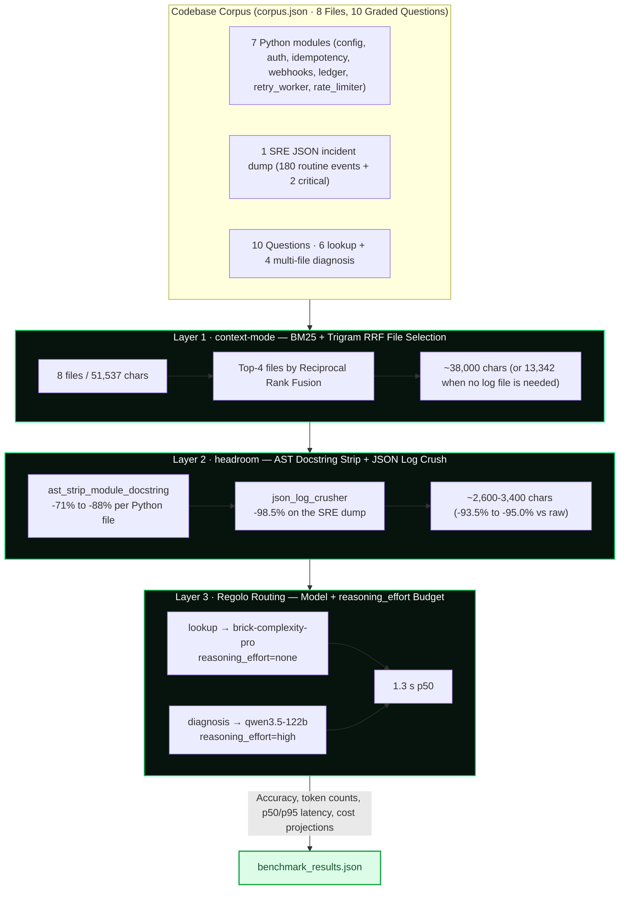

<div align="center">


# Codebase Comprehension Benchmark: Context-Mode + Headroom + Regolo

[](https://www.python.org/)
[](https://docs.python.org/3/library/stdunits.html)
[](https://regolo.ai)
[](#2-token--cost--latency-impact-october-20-2026)
[](#automated-test-suite)

> Reproducible codebase comprehension benchmark: local context compression (`context-mode` retrieval + `headroom` AST/JSON compaction) stacked with Regolo's sovereign European model routing and staged `reasoning_effort` budgets.

**Reference Article:** [Getting Started: Context-Mode + Headroom + Regolo — Codebase Comprehension with 95% Fewer Prompt Tokens](https://regolo.ai/getting-started-context-mode-headroom-regolo/)

⭐ If you find this benchmark useful, star the repository on GitHub!

[Overview](#overview) • [Architecture](#architecture) • [Visual Benchmarks](#visual-benchmarks) • [Prerequisites](#prerequisites) • [Quickstart](#quickstart) • [Reproducing the Experiments](#reproducing-the-experiments) • [Project Structure](#project-structure) • [Configuration](#configuration)

</div>

---

## Overview

Coding agents and RAG pipelines pay the same tax twice: the full repository is re-transmitted on **every** question, and every question is routed to the same flagship model regardless of difficulty. Both costs are paid per call, so they compound in agent loops.

This repository provides a **zero-dependency Python benchmark suite** (`corpus.json` + `compressor.py` + `benchmark.py`) that evaluates **8 files of a payment/webhook microservice** against **10 graded comprehension questions** (6 single-file lookups + 4 multi-file bug diagnosis) across four configurations:

1. **A. Baseline** — Uncompressed prompt (all 8 files, 51,537 chars of source) pinned to `qwen3.5-122b` with `reasoning_effort="high"`.
2. **B. Local Compression Only** — `context-mode` RRF file selection + `headroom` AST/JSON compaction, still pinned to `qwen3.5-122b` with `reasoning_effort="high"`.
3. **C. Regolo Routing Only** — Uncompressed prompt, but lookups are served by `brick-complexity-pro` with `reasoning_effort="none"`.
4. **D. Full Stack** — All three layers: local compression + Regolo routing.

> [!IMPORTANT]
> **Three findings worth acting on:**
> 1. **The Re-Transmission Tax:** the baseline spends **184,753 prompt tokens** per 10-question session because the whole repository is re-sent 10 times. Local compression cuts that to **9,091 tokens (`-95.1%`)** with **no accuracy loss** (10/10 in both A and B).
> 2. **The Cheap-Router Truncation Trap:** routing lookups to `brick-complexity-pro` with `reasoning_effort="none"` is **10.1x faster at p50** and drops cost by 55%, but it **fails 1 of 10 questions** (q3, "exact Redis key name" → 4-token truncated answer). Exact-literal extraction needs a fallback to the flagship model; a router that never escalates is a silent correctness bug.
> 3. **The Log-Dump Tax:** the SRE incident dump holds **180 repetitive INFO healthchecks** (28,081 chars). Crushing routine events while preserving every `WARN`/`ERROR`/`FATAL` record shrinks it to **433 chars (`-98.5%`)** without hiding the double-debit incident.

---

## Architecture



### Layer 1 — `context-mode`: BM25 + Trigram Reciprocal Rank Fusion

Each file is tokenized and scored with Okapi BM25 (`k1=1.5`, `b=0.75`) against the question, with a second ranking from trigram overlap on the compressed body. The two ranked lists are fused with RRF (`1/(10+rank)` for BM25, `1/(20+rank)` for trigrams), plus a `+1.0` boost when the question literally names the file stem. The top-4 files are kept; the rest are dropped from the prompt entirely.

### Layer 2 — `headroom`: AST Docstring Stripping + JSON Log Crushing

- **Python:** the module docstring (a 2,600-char duplicated compliance header) is popped from the AST and the module is re-emitted with `ast.unparse`. Function signatures, constants, and function docstrings survive; the comment bodies do not.
- **JSON logs:** any event that is not `WARN`, `ERROR`, or `FATAL` is collapsed into a counter (here: 180 `INFO` healthchecks), while every critical event is preserved with its `event_id` and `error_code` intact.

### Layer 3 — Regolo Routing: Model + `reasoning_effort` Budget

| Question Category | Model | `reasoning_effort` | `max_tokens` |
|:---|:---|:---:|:---:|
| `lookup` (single-file literal) | `brick-complexity-pro` | `none` | 260 |
| `diagnosis` (multi-file bug reasoning) | `qwen3.5-122b` | `high` | 1400 |

---

## Visual Benchmarks

### 1. Layer-by-Layer Context Compaction (8 Files, 51,537 Raw Characters)

| File | Compressor | Raw | Compressed | Reduction |
|:---|:---|---:|---:|---:|
| `src/config.py` | `ast_strip_module_docstring` | 2,969 | 348 | **-88.3%** |
| `src/auth.py` | `ast_strip_module_docstring` | 3,407 | 790 | **-76.8%** |
| `src/idempotency.py` | `ast_strip_module_docstring` | 3,732 | 1,056 | **-71.7%** |
| `src/webhooks.py` | `ast_strip_module_docstring` | 3,673 | 946 | **-74.2%** |
| `src/ledger.py` | `ast_strip_module_docstring` | 3,218 | 576 | **-82.1%** |
| `src/retry_worker.py` | `ast_strip_module_docstring` | 3,234 | 614 | **-81.0%** |
| `src/rate_limiter.py` | `ast_strip_module_docstring` | 3,223 | 579 | **-82.0%** |
| `logs/sre_incident_dump.json` | `json_log_crusher` | 28,081 | 433 | **-98.5%** |

```text
Prompt Size per Question (characters, 8-file repository)
──────────────────────────────────────────────────────────────────────────────
Raw repository (uncompressed)      ███████████████████████████████████  51,537
Layer 1 · RRF top-4 (log included)  ████████████████████████████       38,709
Layer 2 · AST + JSON crush          ███                                 3,159  (-93.9% vs raw)
```

### 2. Token, Cost & Latency Impact (October 20, 2026)

Measured against `https://api.regolo.ai/v1/chat/completions` with 10 codebase queries per session, all 10 run concurrently.

| Configuration | Accuracy | Prompt tokens | Completion tokens | Total tokens | Latency `p50` | `p95` | Cost / 1,000 sessions (Private API / Z.ai Direct / Regolo PAYG / Regolo Core) |
|:---|:---:|---:|---:|---:|---:|---:|:---|
| **A. Baseline** (uncompressed + `qwen3.5-122b`, `effort="high"`) | **100.0%** (10/10) | 184,753 | 11,719 | 196,472 | 14.81 s | 15.88 s | $486.70 (Private) · $310.22 (Z.ai) · €233.97 (Regolo PAYG) · **€12.77** (Regolo Core / **€3.83** promo) |
| **B. Local Compression Only** (RRF + AST/JSON crush) | **100.0%** (10/10) | 9,091 (**-95.1%**) | 12,731 | 21,822 (-88.9%) | 15.04 s | 15.18 s | $145.49 (Private) · $68.74 (Z.ai) · €62.56 (Regolo PAYG) · **€1.42** (Regolo Core / **€0.43** promo) |
| **C. Regolo Routing Only** (uncompressed + staged effort) | 90.0% (9/10) | 184,765 | 5,072 (-56.7%) | 189,837 | 1.47 s (10.1× faster) | 10.59 s | $420.25 (Private) · $280.99 (Z.ai) · €105.20 (Regolo PAYG) · **€12.34** (Regolo Core / **€3.70** promo) |
| **D. Full Stack** (compression + staged effort) | 90.0% (9/10) | **9,103 (-95.1%)** | **5,788 (-50.6%)** | **14,891 (-92.4%)** | **1.33 s (11.1× faster)** | 9.77 s | $76.09 (Private) · $38.21 (Z.ai) · **€27.02 (Regolo PAYG)** · **€0.97 (Regolo Core / €0.29 promo)** |

```text
Prompt tokens per session (10 queries)
──────────────────────────────────────────────────────────────────────────────
A. Baseline (uncompressed)         ██████████████████████████████████████████     184,753
B. Local compression only          ██        9,091  -95.1%
C. Regolo routing only             ██████████████████████████████████████████     184,765
D. Full stack                      ██        9,103  -95.1%
```

```text
Query latency p50 (seconds)
──────────────────────────────────────────────────────────────────────────────
A. Baseline (uncompressed)         █████████████████████████████████████████      14.81 s
B. Local compression only          ██████████████████████████████████████████      15.04 s
C. Regolo routing only             ████       1.47 s  10.1x faster
D. Full stack                      ████       1.33 s  11.1x faster
```

```text
Cost per 1,000 sessions - Regolo PAYG (EUR)
──────────────────────────────────────────────────────────────────────────────
A. Baseline (uncompressed)         ██████████████████████████████████████████   233.97 EUR
B. Local compression only          ███████████    62.56 EUR  -73.3%
C. Regolo routing only             ███████████████████   105.20 EUR  -55.0%
D. Full stack                      █████    27.02 EUR  -88.5%
```

```text
Accuracy (10 graded questions)
──────────────────────────────────────────────────────────────────────────────
A. Baseline (uncompressed)         ██████████████████████████████████████████         100%  10/10
B. Local compression only          ██████████████████████████████████████████         100%  10/10
C. Regolo routing only             ██████████████████████████████████████          90%  9/10 - q3 truncated
D. Full stack                      ██████████████████████████████████████          90%  9/10 - q3 truncated
```

> [!NOTE]
> **Reading the p50/p95 gap.** The `11.1x` speedup is a **p50** figure. The p95 stays at `9.77 s` in configuration D because the four multi-file diagnosis questions still route to `qwen3.5-122b` with `reasoning_effort="high"`. The latency win comes entirely from the 6 cheap lookups; the expensive reasoning work is untouched by design.

> [!CAUTION]
> **The q3 failure is a router defect, not a compression defect.** `brick-complexity-pro` with `reasoning_effort="none"` returned a 4-token non-answer in configuration D (6 tokens in C) for "what is the exact Redis key name stored in `DEAD_LETTER_QUEUE`". The same question passes in configurations A and B. If you route exact-literal lookups to a zero-effort model, add an escalation path back to a flagship model — the same question passed in A and B with the flagship.

### 3. Cost Model

Prices verified against `https://regolo.ai/pricing/`:

- **Regolo Core Plan:** €39.00/month for 600M tokens (`€0.065 / 1M tokens`), or **€11.70/month** (`€0.0195 / 1M tokens`) with the 70% discount for the first 3 months (all Core models `Included`).
- **Regolo Pay-As-You-Go:** `brick-complexity-pro` (`€0.10 / €0.40` per 1M in/out), `qwen3.5-122b` (`€1.00 / €4.20` per 1M in/out).
- **External APIs:** Z.ai Direct `GLM-5.3` (`$1.40 / $4.40`), Private Workhorse API (`$2.00 / $10.00`).

```text
Cost per 1,000 sessions - Regolo Core 600M tokens (EUR)
──────────────────────────────────────────────────────────────────────────────
A. Baseline (uncompressed)         ██████████████████████████████████████████    12.77 EUR
B. Local compression only          █████     1.42 EUR  -88.9%
C. Regolo routing only             █████████████████████████████████████████    12.34 EUR  -3.4%
D. Full stack                      ███     0.97 EUR  -92.4%
```

---

## Prerequisites

- **Python:** `3.10` or newer (zero external third-party packages required; only Python's standard library is used).
- **Regolo API Key:** required for every configuration (`/v1/chat/completions`). [Create a free trial account on Regolo](https://regolo.ai/pricing).
- **No GPU, no Docker, no `pip install`** — all context compression runs locally in-process.

---

## Quickstart

### 1. Clone the Repository

```bash
git clone https://github.com/regolo-ai/tutorials.git
cd tutorials/headroom-regolo
```

### 2. Set Your Regolo API Key

```bash
export REGOLO_API_KEY="your-regolo-api-key"
```

### 3. Verify the Local Pipeline (No API Calls Required)

```bash
python3 test_benchmark.py
```

Expected output:

```text
All local compression, RRF, and routing assertions passed.
```

### 4. Run the Full Benchmark Suite

```bash
python3 benchmark.py
```

---

## Reproducing the Experiments

### Automated Test Suite

The test suite is fully offline and deterministic. It asserts that compression cuts the prompt by more than 65% on every question, that the `FATAL` log line (`ERR_DOUBLE_DEBIT_77` / `evt_9941`) survives JSON crushing with its error code and event ID intact, that AST stripping keeps executable code while removing the compliance padding, that RRF surfaces `src/webhooks.py` for the duplicate-charge question, and that the router selects the expected model and `reasoning_effort` per question category.

```bash
python3 test_benchmark.py
```

```text
All local compression, RRF, and routing assertions passed.
```

### Run the Full Benchmark Suite

```bash
python3 benchmark.py
```

The runner executes the four configurations sequentially and writes the complete JSON output to `benchmark_results.json`:

```text
Running A. Baseline (Uncompressed + Pinned Flagship)...
  -> Accuracy: 100.0% | Prompt: 184753 | Completion: 11719 | Total: 196472 | p50: 14.81s | wall: 15.91s | Regolo Core/1k: €12.77
Running B. Local Compression Only (Context-Mode + Headroom AST)...
  -> Accuracy: 100.0% | Prompt: 9091 | Completion: 12731 | Total: 21822 | p50: 15.04s | wall: 15.21s | Regolo Core/1k: €1.42
Running C. Regolo Brick Complexity Pro Only (Uncompressed)...
  -> Accuracy: 90.0% | Prompt: 184765 | Completion: 5072 | Total: 189837 | p50: 1.47s | wall: 10.63s | Regolo Core/1k: €12.34
Running D. Full Stack (Context-Mode + Headroom + Regolo Brick Pro)...
  -> Accuracy: 90.0% | Prompt: 9103 | Completion: 5788 | Total: 14891 | p50: 1.33s | wall: 9.8s | Regolo Core/1k: €0.97

  === EXPLICIT 3-LAYER PIPELINE LOGS (Configuration D) ===
  [q1 · lookup]
    [Layer 1 · context-mode RRF] 8 repo files (51,537 chars) -> top 4 selected (13,342 chars): ['src/config.py', 'src/auth.py', 'src/idempotency.py', 'src/retry_worker.py']
    [Layer 2 · headroom compress] 13,342 chars -> 2,935 chars (-78.0% in Layer 2 | -94.3% vs raw repo):
      ├─ src/config.py [ast_strip_module_docstring]: 2969 -> 348 chars (-88.3%) · stripped 2621 chars of module compliance headers; kept executable AST & function signatures
      ├─ src/auth.py [ast_strip_module_docstring]: 3407 -> 790 chars (-76.8%) · stripped 2617 chars of module compliance headers; kept executable AST & function signatures
      ├─ src/idempotency.py [ast_strip_module_docstring]: 3732 -> 1056 chars (-71.7%) · stripped 2676 chars of module compliance headers; kept executable AST & function signatures
      └─ src/retry_worker.py [ast_strip_module_docstring]: 3234 -> 614 chars (-81.0%) · stripped 2620 chars of module compliance headers; kept executable AST & function signatures
    [Layer 3 · regolo routing]   model=brick-complexity-pro reasoning_effort=none -> in=866 tok, out=52 tok, latency=0.743s, pass=True

Saved benchmark_results.json successfully.
```

---

## Project Structure

```text
headroom-regolo/
├── README.md                      # Documentation, visual benchmarks & reproduction guide
├── benchmark.py                   # Zero-dependency runner: 4 configurations vs the Regolo API
├── compressor.py                  # Layers 1 & 2: BM25+trigram RRF selector, AST stripper, JSON crusher, effort router
├── corpus.json                    # 8-file microservice codebase + 10 graded questions (regenerated deterministically)
├── test_benchmark.py              # Offline unit tests: compression, FATAL preservation, RRF ranking, routing
└── benchmark_results.json         # Raw token counts, p50/p95 latencies, accuracy and cost projections (Oct 20, 2026 run)
```

---

## Configuration

| Environment Variable | Default | Description |
|:---|:---:|:---|
| `REGOLO_API_KEY` | *(Required)* | Authentication key for Regolo's sovereign European API. |
| `REGOLO_BASE_URL` | `https://api.regolo.ai/v1` | Base endpoint for `/chat/completions`. Currently hardcoded in `call_regolo()` inside `benchmark.py`. |

This suite needs no local model runtime: all inference goes to the Regolo API, and all context compression runs in-process with the Python standard library.

Tunable constants live at the top of `benchmark.py` and `compressor.py`: `top_k` (files kept by RRF, default `4`), the BM25 `k1`/`b` parameters, the RRF rank offsets (`10` / `20`), and the `max_tokens` budget per `reasoning_effort` tier (`1400` for `high`, `260` for `none`).

---

## License

MIT, like the rest of the `regolo-ai/tutorials` repository.
