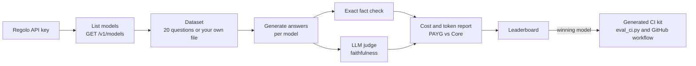

<div align="center">


# Regolo Eval Studio: multi-model evaluation, FinOps break-even and a Langfuse CI gate for open-weight models

[](https://www.python.org/)
[](https://docs.python.org/3/library/)
[](https://regolo.ai)
[](https://langfuse.com)
[](../LICENSE)

> A local web studio and command line tool that benchmarks open-weight models on your own dataset through the Regolo API. It scores each answer, works out whether PAYG or the flat Regolo Core plan is cheaper for your workload, optionally streams traces into Langfuse, and generates a GitHub Actions gate that fails a pull request when faithfulness drops.

**Reference guide on regolo.ai:** [Tracing and evaluating open-weight models on Regolo with Langfuse](https://regolo.ai/tracing-evaluating-open-weight-models-regolo-langfuse/)

</div>

---

## Overview

Choosing a model for a RAG feature is a three-way decision: quality, latency and cost. Langfuse shows you traces once your code is instrumented, but it does not tell you which model to pick, what your monthly bill would be under each Regolo plan, or whether a new model version has quietly lost faithfulness.

This studio fills those gaps. You give it a dataset, a few models and an API key. It runs the same questions through each model, scores the answers, and reports the cost under both pricing schemes. When you are happy with the winner, it generates a CI gate that repeats the check on every pull request.

The sections below list the measures, the run flow and the commands to start the studio.

---

## What the studio measures

Every run produces the same set of figures, so you can compare models side by side.

| Measure | How it is computed | Why it matters |
|:---|:---|:---|
| **Exact fact** | Deterministic check: does the answer contain the expected fact? | Free, and it does not depend on another model |
| **Faithfulness** | An LLM judge answers 1 or 0 on whether the answer uses only facts from the context | Catches answers that sound right but invent details |
| **Hidden reasoning ratio** | Tokens in `reasoning_content` compared with visible answer tokens | Reasoning models can bill far more than the answer shows |
| **PAYG cost** | Token counts times the Regolo pay-as-you-go price in `prices.json` | The real cost for a light or irregular workload |
| **Core cost** | Flat plan of 39 EUR per month for 600 million tokens, or 11.70 EUR during the 3-month promotion | The cost for a steady, high-volume workload |
| **Break-even** | Number of evaluation runs at which the flat plan becomes cheaper than PAYG | Tells you when a subscription pays off |

---

## How a run works



The wizard keeps the API key in memory in the browser tab and sends it only to the local server, which forwards it to `https://api.regolo.ai/v1`. The key is never written to disk.

---

## Project structure

```text
langfuse-eval-studio/
├── README.md                    this file
├── regolo_eval_tui.py           CLI entry point (self-check) and the shared engine
├── corpus.json                  the 20-question regolo-docs-qa RAG dataset
└── eval_wizard/
    ├── server.py                local HTTP server and evaluation jobs (port 8230 by default)
    ├── test_server.py           unit tests for the server and the engine
    ├── prices.json              Regolo pricing used for PAYG and Core maths
    └── static/
        ├── index.html           the four-step web wizard
        ├── fonts/               Space Grotesk, used by the design system
        └── regolo-*.png         logo assets
```

---

## Requirements

- Python 3.10 or later. The studio and the engine use only the standard library.
- A Regolo API key. Sign up at [regolo.ai/pricing](https://regolo.ai/pricing) for 30 days free, with a discount on the first 3 months.
- For the generated CI gate only: the `langfuse` Python SDK (version 4.6 or later) and `openai`. These are installed by the GitHub workflow, not by the studio.
- Optional: a Langfuse project, either Langfuse Cloud or a self-hosted instance, if you want traces and scores in Langfuse.

---

## Quickstart

```bash
cd langfuse-eval-studio

# 1. Run the deterministic self-check and the unit tests (no API key needed)
python3 regolo_eval_tui.py --demo
python3 eval_wizard/test_server.py

# 2. Start the web studio and open http://127.0.0.1:8230
python3 eval_wizard/server.py

# Use --no-open to start the server without opening the browser,
# or --port to choose another port.
python3 eval_wizard/server.py --port 8240 --no-open
```

The four steps of the wizard are:

1. **Connect.** Paste your Regolo API key. Optionally, open the Langfuse section and enter the host and project keys.
2. **Choose.** Pick one model, or two for a side-by-side comparison. The list comes live from your account.
3. **Evaluate.** Use the 20-question corpus or upload your own `.json`, `.jsonl` or `.csv` file. Set the number of items and the faithfulness threshold, which defaults to 0.85.
4. **Decide.** Read the leaderboard, the PAYG and Core break-even figures and the CI gate verdict. Then download the CI kit.

---

## Use the generated CI gate

When a run finishes, the studio produces two files for the winning model:

- `eval_ci.py` runs the dataset as a Langfuse experiment with `dataset.run_experiment`, sends the traces and scores, and raises `RegressionError` when average faithfulness falls below the threshold.
- `.github/workflows/regolo-eval.yml` runs `eval_ci.py` on every pull request to `main`.

Add these four repository secrets before you enable the workflow:

| Secret | Value |
|:---|:---|
| `REGOLO_API_KEY` | Your Regolo key |
| `LANGFUSE_HOST` | Your Langfuse host, for example `https://cloud.langfuse.com` |
| `LANGFUSE_PUBLIC_KEY` | Your Langfuse public key |
| `LANGFUSE_SECRET_KEY` | Your Langfuse secret key |

The pull request then shows a short report with the model, the judge, the measured faithfulness and the verdict.

---

## API reference (local server)

The wizard talks to these endpoints on `127.0.0.1`. They are useful if you want to script a run.

| Method | Path | Purpose |
|:---|:---|:---|
| `GET` | `/api/dataset` | Returns the built-in 20-question corpus |
| `POST` | `/api/models` | Lists the models available to the key you send in the body |
| `POST` | `/api/evaluate` | Starts an evaluation job and returns its id |
| `GET` | `/api/jobs/<id>` | Returns the progress and, when finished, the full report |

---

## Models and pricing

Pricing lives in `eval_wizard/prices.json` and is used for every PAYG calculation. The flat plans are hard coded in the engine and the server:

| Plan | Price | Included tokens |
|:---|---:|---:|
| **PAYG** | Per token, from `prices.json` | Unlimited, billed per use |
| **Core** | 39 EUR per month (11.70 EUR during the 3-month promotion) | 600 million per month |

If a model is not in `prices.json`, its PAYG cost shows as `n/a (unpriced slug)` rather than a guessed number. Check the file before you rely on a cost, because Regolo prices can change.

---

## Tests and checks

| Command | What it checks | Needs an API key |
|:---|:---|:---|
| `python3 regolo_eval_tui.py --demo` | Multi-model engine, dataset parser, FinOps maths and the CI generator | No |
| `python3 eval_wizard/test_server.py` | Four unit tests for the server and the engine | No |

---

## Troubleshooting

- **The model list is empty.** Check that the key was pasted in full, with no trailing spaces. Then confirm that the key can call `https://api.regolo.ai/v1/models`.
- **The port is already in use.** Start the server with `--port` and another number, then open that port in the browser.
- **The Langfuse section shows no traces.** Check that the host includes the protocol, for example `https://cloud.langfuse.com` or `http://localhost:3000`, and that the public and secret keys belong to the same project.
- **The CI gate fails.** Read the report on the pull request. A `RegressionError` means average faithfulness is below the threshold. Compare the change with the last passing run before you lower the threshold.

---

## License & third-party notices

Apache 2.0, like the rest of the `regolo-ai/tutorials` repository. See [LICENSE](../LICENSE).

The web design follows the Regolo Studio system, with the Space Grotesk font under the SIL Open Font License.
