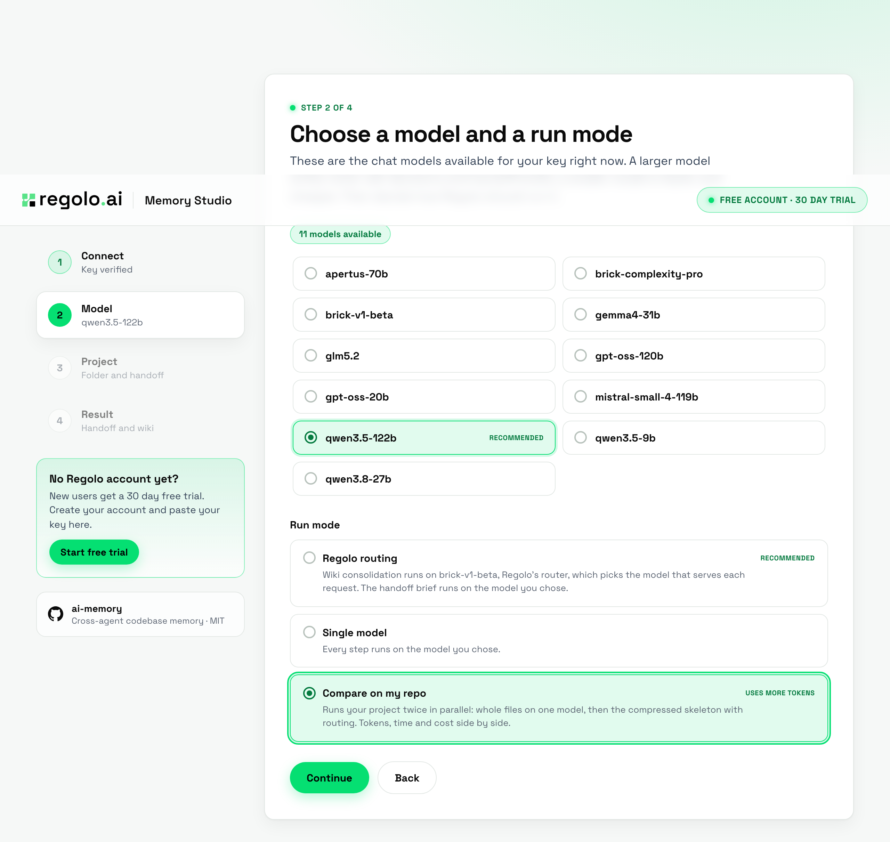
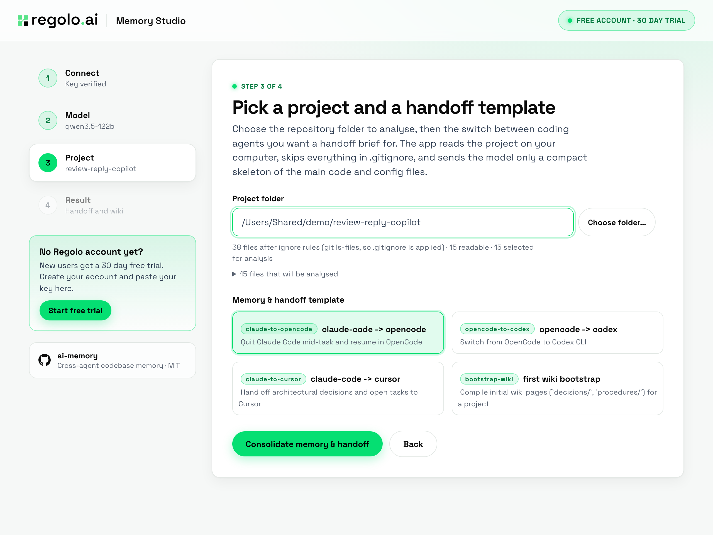

<div align="center">


# Regolo Memory Studio: Cross-Agent Codebase Memory & Handoffs, Measured on Regolo

[](https://www.python.org/)
[](https://docs.python.org/3/library/)
[](https://regolo.ai)
[](#visual-benchmarks)

> A local web app and terminal TUI that turns a project folder into Markdown wiki pages and a handoff brief for the next coding agent (Claude Code -> OpenCode -> Codex), and measures whole-file prompts against a compressed skeleton with Regolo routing. Inspired by the cross-agent memory ideas of the open source [ai-memory](https://github.com/akitaonrails/ai-memory) project by Fabio Akita (MIT). Independent implementation, not affiliated with or endorsed by ai-memory.

**Reference Article:** [Getting started with ai-memory and regolo: persistent codebase memory across opencode, claude code, and codex](https://regolo.ai/getting-started-ai-memory-regolo-persistent-codebase-memory/)

</div>

---

## Overview

When you switch between Claude Code, OpenCode, Codex, or Cursor mid-task, built-in agent notes remain locked in one vendor's folder. The next agent starts cold, re-reads the repository tree, and burns tens of thousands of warm-up tokens.

This repository provides a **zero-dependency Python web app** (`memory_wizard/server.py`), a **command line script for real projects** (`consolidate.py`), a **terminal TUI** (`regolo_memory_tui.py`), and an **offline 4-configuration benchmark** (`benchmark.py`).



---

## Visual Benchmarks

### 1. Compare mode on a real repository (Review Reply Copilot, October 26, 2026)

Five runs in the web app, each one baseline and one optimized run started in parallel (the fifth is the one recorded in the YouTube tutorial). Template `claude-code -> opencode`, handoff brief on `qwen3.5-122b`, 15 files selected from 38 after `.gitignore`.

| Metric | Baseline (whole files, `qwen3.5-122b` for every step) | Optimized (compressed skeleton, consolidation on `brick-v1-beta`) | Change |
|:---|---:|---:|---:|
| **Prompt tokens** | 28,630 to 28,743 | 7,808 to 7,855 | **−73%** |
| **Total tokens** | 30,321 to 30,620 | 9,366 to 9,465 | **−69%** |
| **Wall time** | 13.8 to 22.1 s | 11.5 to 16.3 s | **−4% to −28%** |
| **Regolo PAYG cost** | €0.036 to €0.037 | €0.0066 to €0.0069 | **−81% to −82%** |

`brick-v1-beta` is Regolo's router: in every run it served the consolidation step with `qwen3.5-9b` (the app shows the served model in the per step table and in each page's `consolidated_by`). Its pages were usable in 5 of 5 runs, so no step was repeated. It is priced at €0.00 while in beta (regolo.ai/pricing, checked October 26, 2026), so part of the cost change comes from that price. Billed at `qwen3.5-9b`'s price (€0.07 / €0.35 per million tokens) the optimized run would cost about €0.0075, still about −79%.


### 2. Offline 4-Configuration Benchmark (6 Graded Questions, October 20, 2026)

Measured before the app moved to `brick-v1-beta`: routing in this table is `brick-complexity-pro`, as in `benchmark.py`.

| Configuration | Accuracy | Prompt tokens | Total tokens | Latency `p50` | Regolo PAYG / 1k | Regolo Core / 1k |
|:---|:---:|---:|---:|---:|---:|---:|
| **A. Cold Session Baseline** (`qwen3.5-122b`) | 100.0% (6/6) | 52,262 | 57,662 | 10.92 s | €74.94 | **€3.75** (€1.12 promo) |
| **B. Wiki + Handoff Only** (`qwen3.5-122b`) | 100.0% (6/6) | 2,477 (−95.3%) | 7,733 (−86.6%) | 10.30 s | €24.55 | **€0.50** (€0.15 promo) |
| **C. Regolo Routing Only** (`brick-complexity-pro`) | 100.0% (6/6) | 52,270 | 54,216 (−6.0%) | 1.44 s | €28.55 | **€3.52** (€1.06 promo) |
| **D. Full Stack** (Wiki + Handoff + Routing) | **100.0% (6/6)** | **2,485 (−95.2%)** | **4,490 (−92.2%)** | **0.78 s (14.0×)** | **€8.73** | **€0.29** (€0.09 promo) |

---

## Use it in a real project

The web app is for looking and measuring. For day-to-day work, `consolidate.py` runs the same scan, redaction and routing from the command line and writes the pages into the project you analyse:

```bash
export REGOLO_API_KEY=...            # or pass --env-file path/to/.env
python3 consolidate.py --project ~/code/my-app --template claude-to-opencode
# writes ~/code/my-app/docs/memory/{decisions,procedures,handoffs}/*.md and prints tokens, time and cost per step
```

Then make your agents read it:

1. **Commit the pages.** `docs/memory/` is plain Markdown. Review it in the pull request like any other doc, because it is model output.
2. **Point each agent at it.** Add one line to the files your agents already read on start: `CLAUDE.md` for Claude Code, `AGENTS.md` for OpenCode and Codex, `.cursor/rules/` for Cursor. For example: "Before you start, read `docs/memory/handoffs/` and `docs/memory/decisions/`. Do not repeat the failed approaches listed there."
3. **Refresh it when you switch.** Run `consolidate.py` at the end of a session, before you hand the task to another agent, or from a `pre-push` hook. A page with the same name is overwritten, but the model often picks new names, so old pages stay next to the new ones. Delete `docs/memory/` before a run when you want a clean set, and let `git diff` show what changed.

Memory Studio reads only the code and config files of the project (at most 16, comments dropped, values on key, secret, token and password lines redacted, dot files never read). It does not see your agents' chat history, so "where we left off" is inferred from the code. For memory built from real sessions, use ai-memory itself.

### With ai-memory on Regolo

[ai-memory](https://github.com/akitaonrails/ai-memory) captures every session through hooks, keeps its own wiki and creates claim-once handoffs between agents. It does not import Memory Studio's pages. To run its consolidation and embeddings on Regolo, use its `openai-compat` provider ([upstream docs](https://github.com/akitaonrails/ai-memory/blob/main/docs/llm-providers.md)). This is the configuration the app prints under the inspector:

```bash
LLM_API_KEY="<your Regolo key>"
AI_MEMORY_LLM_PROVIDER="openai-compat"
AI_MEMORY_LLM_BASE_URL="https://api.regolo.ai/v1"
AI_MEMORY_LLM_MODEL="qwen3.5-122b"
AI_MEMORY_LLM_COMPAT_STRICT="true"
AI_MEMORY_LLM_COMPAT_DISABLE_THINKING="true"
AI_MEMORY_EMBEDDING_PROVIDER="openai-compat"
AI_MEMORY_EMBEDDING_BASE_URL="https://api.regolo.ai/v1"
AI_MEMORY_EMBEDDING_MODEL="Qwen3-Embedding-8B"
AI_MEMORY_EMBEDDING_DIM="4096"
```

The variable names come from ai-memory's docs, and `Qwen3-Embedding-8B` returning 4,096 dimensions was checked against Regolo's API on October 26, 2026. We have not run the ai-memory server with this file: check it with `ai-memory llm-test --provider openai-compat` before you rely on it.

---

## Quickstart

```bash
git clone https://github.com/regolo-ai/tutorials.git
cd tutorials/memory-studio
python3 -m unittest memory_wizard/test_server.py && python3 test_benchmark.py
python3 memory_wizard/server.py      # opens http://127.0.0.1:8210
python3 consolidate.py --project /path/to/your/repo   # writes docs/memory/ inside that repo
# Or run the terminal TUI:
python3 regolo_memory_tui.py
```



---

## License & Third-Party Notices

MIT, like the rest of the `regolo-ai/tutorials` repository. Fonts: Space Grotesk (SIL Open Font License).

### Third-Party Notices

This repository is an independent Python implementation (web app, command line script, terminal TUI, and benchmark runner). It does not bundle or redistribute code from `ai-memory`, is not affiliated with or endorsed by that project, and writes pages in its own format, which ai-memory does not read. Its cross-agent handoff and repository wiki consolidation concepts are inspired by [akitaonrails/ai-memory](https://github.com/akitaonrails/ai-memory):

- **ai-memory** — Copyright (c) 2026 Fabio Akita (`@akitaonrails`), licensed under the [MIT License](https://github.com/akitaonrails/ai-memory/blob/main/LICENSE).
