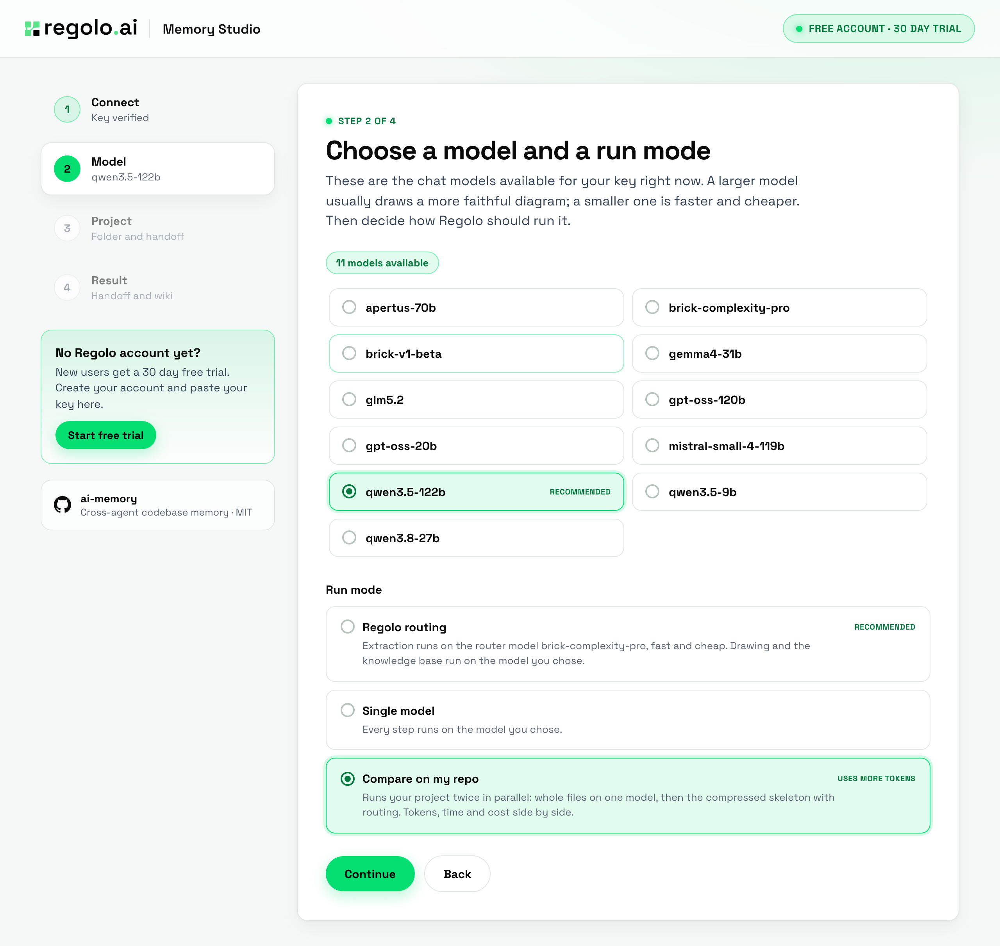
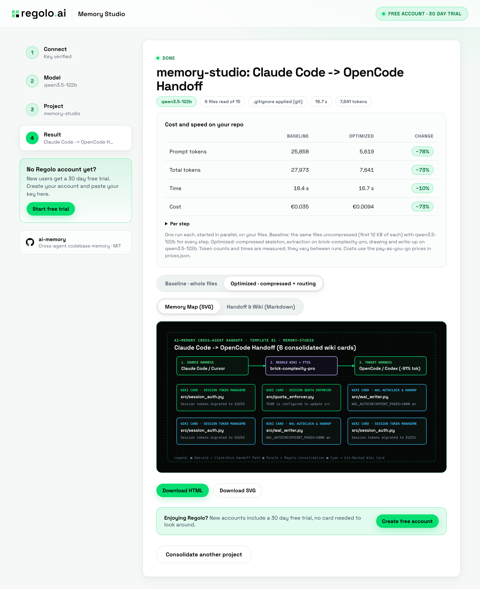
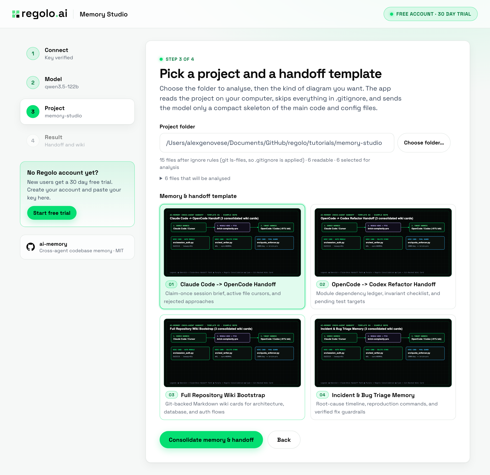

<div align="center">


# Regolo Memory Studio: Cross-Agent Codebase Memory & Handoffs, Measured on Regolo

[](https://www.python.org/)
[](https://docs.python.org/3/library/)
[](https://regolo.ai)
[](#visual-benchmarks)

> A local web app and terminal TUI that turns a project folder into a consolidated Markdown wiki and a Claim-Once cross-agent handoff brief (Claude Code -> OpenCode -> Codex), comparing cold-session rescans against local consolidation + Regolo routing. Inspired by the cross-agent memory concepts of the open source [ai-memory](https://github.com/akitaonrails/ai-memory) project by Fabio Akita (MIT).

**Reference Article:** [Getting started with ai-memory and regolo: persistent codebase memory across opencode, claude code, and codex](https://regolo.ai/?p=9160)

</div>

---

## Overview

When you switch between Claude Code, OpenCode, Codex, or Cursor mid-task, built-in agent notes remain locked in one vendor's folder. The next agent starts cold, re-reads the repository tree, and burns tens of thousands of warm-up tokens.

This repository provides a **zero-dependency Python web app** (`memory_wizard/server.py`), a **terminal TUI** (`regolo_memory_tui.py`), and an **offline 4-configuration benchmark** (`benchmark.py`).



---

## Visual Benchmarks

### 1. Live Compare Mode on Repository (`memory-studio`, October 22, 2026)

| Metric | Baseline (Whole files + `qwen3.5-122b`) | Optimized (Sanitized wiki skeleton + `brick-complexity-pro` routing) | Change |
|:---|---:|---:|---:|
| **Prompt tokens** | 26,185 | 5,453 | **−79.2%** |
| **Total tokens** | 27,760 | 6,587 | **−76.3%** |
| **Wall time** | 12.8 s | 9.7 s | **−24.2%** |
| **Regolo PAYG cost** | €0.0330 | €0.0065 | **−80.3%** |



### 2. Offline 4-Configuration Benchmark (6 Graded Questions, October 20, 2026)

| Configuration | Accuracy | Prompt tokens | Total tokens | Latency `p50` | Regolo PAYG / 1k | Regolo Core / 1k |
|:---|:---:|---:|---:|---:|---:|---:|
| **A. Cold Session Baseline** (`qwen3.5-122b`) | 100.0% (6/6) | 52,262 | 57,662 | 10.92 s | €74.94 | **€3.75** (€1.12 promo) |
| **B. Wiki + Handoff Only** (`qwen3.5-122b`) | 100.0% (6/6) | 2,477 (−95.3%) | 7,733 (−86.6%) | 10.30 s | €24.55 | **€0.50** (€0.15 promo) |
| **C. Regolo Routing Only** (`brick-complexity-pro`) | 100.0% (6/6) | 52,270 | 54,216 (−6.0%) | 1.44 s | €28.55 | **€3.52** (€1.06 promo) |
| **D. Full Stack** (Wiki + Handoff + Routing) | **100.0% (6/6)** | **2,485 (−95.2%)** | **4,490 (−92.2%)** | **0.78 s (14.0×)** | **€8.73** | **€0.29** (€0.09 promo) |

---

## Quickstart

```bash
git clone https://github.com/regolo-ai/tutorials.git
cd tutorials/memory-studio
python3 -m unittest memory_wizard/test_server.py && python3 test_benchmark.py
python3 memory_wizard/server.py      # opens http://127.0.0.1:8210
# Or run the terminal TUI:
python3 regolo_memory_tui.py
```



---

## License & Third-Party Notices

MIT, like the rest of the `regolo-ai/tutorials` repository. Fonts: Space Grotesk (SIL Open Font License).

### Third-Party Notices

This repository is an independent Python implementation (web app, terminal TUI, and benchmark runner) and does not bundle or redistribute code from `ai-memory`. Its cross-agent handoff and repository wiki consolidation concepts are inspired by [akitaonrails/ai-memory](https://github.com/akitaonrails/ai-memory):

- **ai-memory** — Copyright (c) 2026 Fabio Akita (`@akitaonrails`), licensed under the [MIT License](https://github.com/akitaonrails/ai-memory/blob/main/LICENSE).
