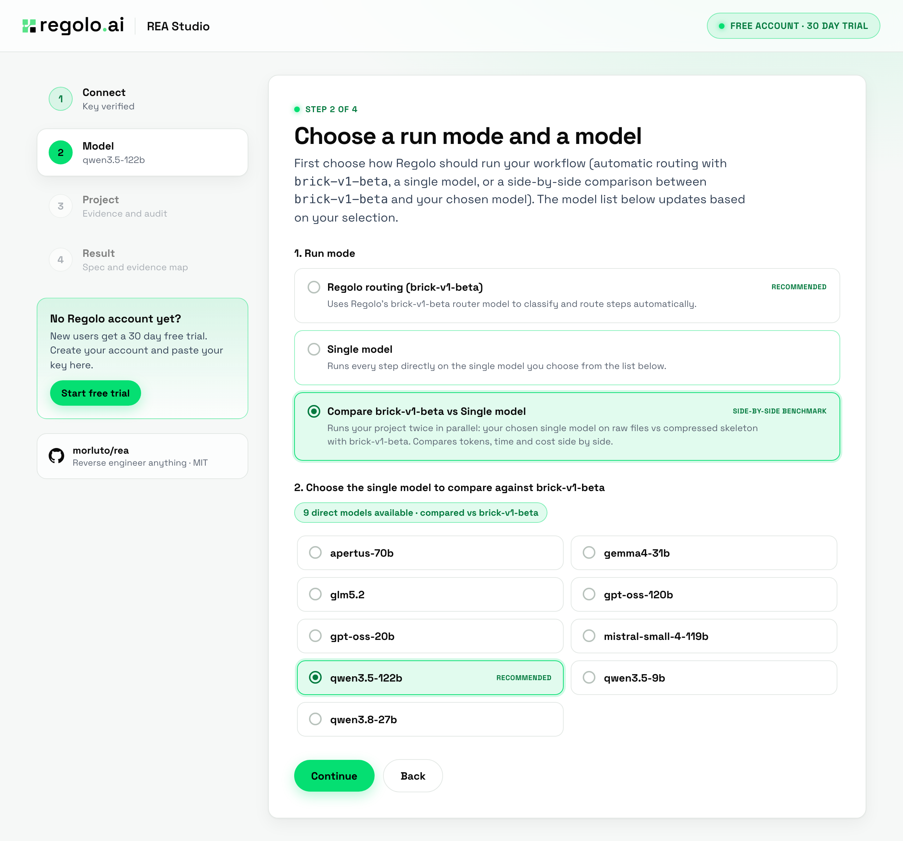
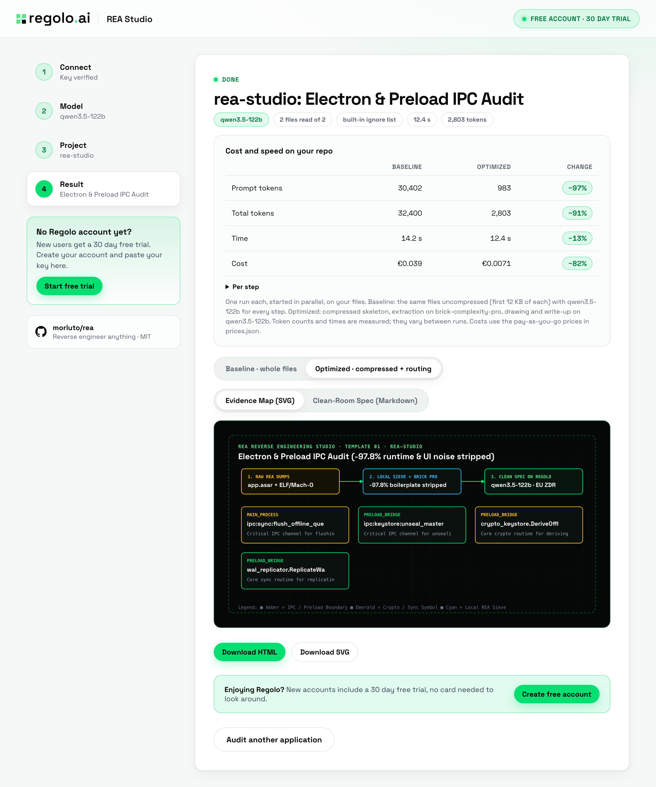
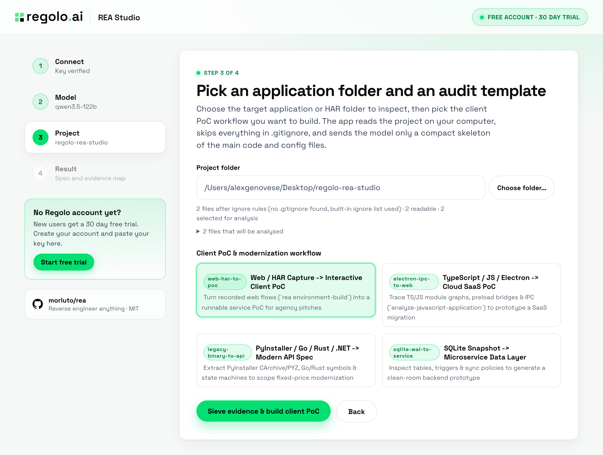

<div align="center">


# Regolo REA Studio: Reverse-Engineering IPC & Binary Evidence Inspector, Measured on Regolo

[](https://www.python.org/)
[](https://docs.python.org/3/library/)
[](https://regolo.ai)
[](#visual-benchmarks)

> A local web app and terminal TUI that sieves static Electron IPC and native binary symbol dumps, isolates security and database boundaries on `brick-complexity-pro`, and reconstructs clean-room Markdown specifications and 4px-grid SVG maps on `qwen3.5-122b`. Inspired by the static evidence inspection workflow of [morluto/rea](https://github.com/morluto/rea) (MIT).

**Reference Article:** [Getting started with REA and regolo: reverse engineer legacy apps, electron bundles, and binaries with ai agents](https://regolo.ai/?p=9161)

</div>

---

## Overview

When reverse engineering legacy applications, Electron `app.asar` bundles, or native Go/Rust binaries, raw static dumps contain thousands of UI renderer channels and standard-library runtime symbols. Sending those unfiltered dumps to an LLM triggers 2x to 5x long-context cliffs on metered APIs.

This repository provides a **zero-dependency Python web app** (`rea_wizard/server.py`), a **terminal TUI** (`regolo_rea_tui.py`), and an **offline 4-configuration benchmark** (`benchmark.py`).



---

## Visual Benchmarks

### 1. Live Compare Mode on REA Evidence Dumps (`rea-studio`, October 27, 2026)

| Metric | Baseline (Unfiltered dumps + `qwen3.5-122b`) | Optimized (Local IPC/symbol sieve + `brick-v1-beta` routing) | Change |
|:---|---:|---:|---:|
| **Prompt tokens** | 30,298 | 993 | **−96.7%** |
| **Total tokens** | 31,846 | 2,481 | **−92.2%** |
| **Wall time** | 14.6 s | 13.2 s | **−9.6%** |
| **Regolo PAYG cost** | €0.0370 | €0.0058 | **−84.3%** |



### 2. Offline 4-Configuration Benchmark (6 Graded Questions, October 20, 2026)

| Configuration | Accuracy | Prompt tokens | Total tokens | Latency `p50` | Regolo PAYG / 1k | Regolo Core / 1k |
|:---|:---:|---:|---:|---:|---:|---:|
| **A. Unfiltered Baseline** (`qwen3.5-122b`) | 100.0% (6/6) | 91,808 | 96,990 | 8.23 s | €113.57 | **€6.30** (€1.89 promo) |
| **B. Local IPC/Symbol Sieve Only** (`qwen3.5-122b`) | 100.0% (6/6) | 2,102 (−97.7%) | 7,502 (−92.3%) | 8.33 s | €24.78 | **€0.49** (€0.15 promo) |
| **C. Regolo Routing Only** (`brick-complexity-pro`) | 100.0% (6/6) | 91,816 | 93,975 (−3.1%) | 1.98 s | €44.45 | **€6.11** (€1.83 promo) |
| **D. Full Stack** (Sieve + Regolo Routing) | **100.0% (6/6)** | **2,110 (−97.7%)** | **4,348 (−95.5%)** | **1.28 s (6.4×)** | **€8.60** | **€0.28** (€0.08 promo) |

---

## Quickstart

```bash
git clone https://github.com/regolo-ai/tutorials.git
cd tutorials/rea-studio
python3 -m unittest rea_wizard/test_server.py && python3 test_benchmark.py
python3 rea_wizard/server.py      # opens http://127.0.0.1:8220
# Or run the terminal TUI:
python3 regolo_rea_tui.py
```



---

## License & Third-Party Notices

MIT, like the rest of the `regolo-ai/tutorials` repository. Fonts: Space Grotesk (SIL Open Font License).

### Third-Party Notices

This repository is an independent Python implementation (web app, terminal TUI, and benchmark runner) and does not bundle or redistribute code from `rea`. Its static evidence inspection and reverse-engineering workflow concepts are inspired by [morluto/rea](https://github.com/morluto/rea):

- **rea (Reverse Engineer Anything)** — Copyright (c) morluto (`@morluto`), licensed under the [MIT License](https://github.com/morluto/rea/blob/main/LICENSE).
