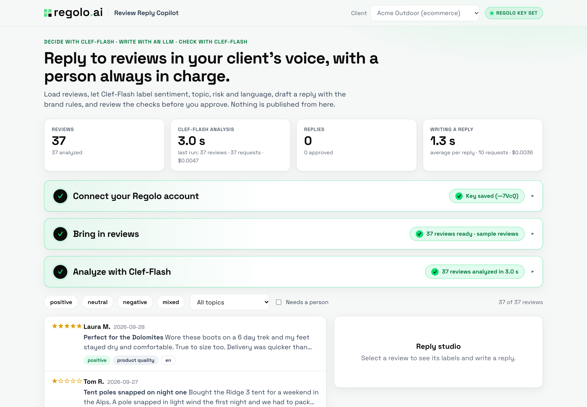
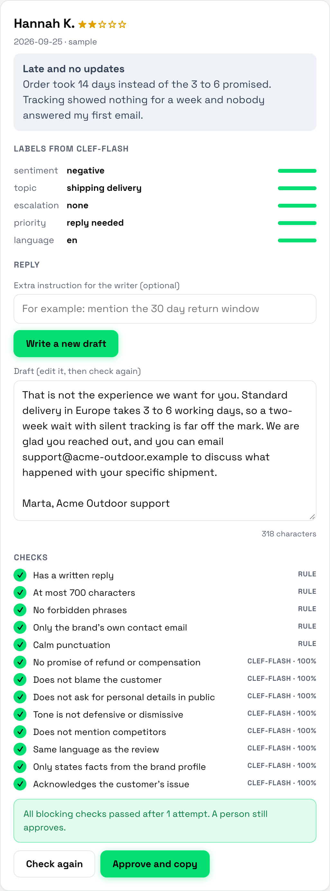

# Review Reply Copilot

A small, local web app for agencies and in-house teams that answer customer reviews for e-commerce and SaaS brands. It shows a pattern we think works well in production: **decide with Clef-Flash, write with an LLM, check with Clef-Flash, and let a person approve.**



## What it does

1. **Connects your Regolo account.** Step 1 of the interface has a form to paste and save your API key (verified against Regolo's catalog, stored in `.env` on this computer), and a link to create an account: new users get 30 days of free trial, see <https://regolo.ai/pricing> for the current terms.
2. **Collects reviews** from the sample files or a CSV file (with a downloadable template and the list of columns it expects). The app does not scrape review sites: take the export from the review tool your client uses. See [docs/importing-reviews.md](docs/importing-reviews.md).
3. **Labels each review with Clef-Flash** on Regolo, with a live progress bar: sentiment, topic (defined per client), whether a person must handle it first (legal threat, safety, fraud accusation, privacy request, press), whether a reply is needed, and the language. Every label comes with a confidence value, and low confidence cases are flagged.
4. **Drafts a reply with a chat model** (`qwen3.8-27b` by default) using the client's brand profile: voice, the only facts it may state, things it must never do, forbidden phrases, signature and length.
5. **Checks the draft** with plain rules (length, forbidden phrases, contact details) and with Clef-Flash yes or no questions (promises compensation, blames the customer, defensive tone, mentions a competitor, same language as the review, acknowledges the issue). If a blocking check fails, the writer gets the list of problems and tries once more.
6. **Waits for a person.** Nothing is published from the app. Reviews that need a person get a neutral holding reply and cannot be marked ready. Approving copies the text so you post it from the platform's own console.



## Run it

```bash
git clone https://github.com/regolo-ai/tutorials.git
cd tutorials/review-reply-copilot
./run.sh                    # creates .env on first run, then open http://127.0.0.1:8100
```

Paste your key in step 1 (or put `REGOLO_API_KEY` in `.env`), click **Load sample reviews**, then **Analyze with Clef-Flash**. The reviews stay hidden until the analysis finishes. Select one and choose **Write a draft**. You need Python 3.10 or newer (we tested on 3.14) and a Regolo API key from <https://regolo.ai>.

## Configuration

| Variable | Default | Meaning |
|---|---|---|
| `REGOLO_API_KEY` | none | your key |
| `REGOLO_CHAT_MODEL` | `qwen3.8-27b` | writes the draft replies |
| `REGOLO_DECISION_MODEL` | `clef-flash` | labels reviews and checks drafts |
| `REGOLO_REASONING_EFFORT` | `none` | `none` turns reasoning off for the writing model, `default` leaves it on |
| `HOST`, `PORT` | `127.0.0.1`, `8100` | where the app listens |

## Brand profiles

Each client is one JSON file in `brands/`. Adding a client is adding a file, and changing a rule is changing a sentence.

```json
{
  "id": "acme-outdoor", "name": "Acme Outdoor", "type": "ecommerce",
  "voice": ["warm", "direct", "plain language"],
  "topics": {"shipping_delivery": "The customer talks about delivery time, tracking or a damaged parcel.", "...": "..."},
  "facts": ["Returns are accepted within 30 days of delivery for unused items."],
  "never": ["promise a refund, replacement, discount or any compensation in a public reply"],
  "forbidden_phrases": ["we apologize for any inconvenience"],
  "support_contact": "support@acme-outdoor.example", "signature": "Marta, Acme Outdoor support", "max_chars": 700
}
```

The topic list is what Clef-Flash chooses from, so an e-commerce client and a SaaS client get different topics with no code change (see `brands/northwind-cloud.json`).

## What we measured

On the two sample files (37 and 35 synthetic reviews, written for this demo), on October 14, 2026, from one machine:

| Step | Result |
|---|---|
| Label 37 reviews with Clef-Flash (5 questions each, 8 requests in parallel) | about 3 to 5 seconds, estimated 0.005 USD, about 0.13 USD per 1,000 reviews |
| Write and check one reply (reasoning off) | usually 1 to 3 seconds, one of nine took 17 seconds, about 0.0004 USD for the writing step |
| Same reply with the reasoning model left on | 14 to 74 seconds in our first test |

Two findings shaped the code. **Batch size matters for subtle decisions:** with 12 reviews in one Clef-Flash request (60 questions), the escalation question flagged 12 of 37 reviews when about 5 deserved it, with 4 reviews per request it flagged 5 plus some false alarms in the SaaS file, and with one review per request the flags matched what we expected, at lower token cost and about the same wall time. **Define what does not count:** the first escalation definition flagged angry but ordinary reviews until we added what belongs in the "none" category.

Costs are estimates from the tokens reported by the API and the Regolo catalog rates, not an invoice.

## Limits you should know

- The sample reviews are synthetic and the app has not been measured on a labeled set of real reviews, so treat the labels as a first pass and read the low confidence ones.
- Clef-Flash can be confidently wrong, and the draft checks are a filter and not a guarantee. A person approves every reply.
- Reviews contain personal data. They are stored in a local SQLite file (`data/app.db`, ignored by git), and inference runs on Regolo, which keeps no data after each request. Compliance still depends on how you develop and operate your own processes.

## Project layout

```
app/classify.py     Clef-Flash labels for each review
app/reply.py        brand-aware draft with a repair loop
app/guardrails.py   rules and Clef-Flash checks on the draft
app/regolo.py       client with time, token and cost meter
app/account.py      save and verify the Regolo key
app/main.py         FastAPI endpoints
app/static/         the interface (plain HTML, CSS and JavaScript)
brands/             one JSON profile per client
data/               synthetic sample reviews and the CSV template
tests/              23 offline tests
```

Run the tests with `.venv/bin/python -m pytest`. They use a fake client, so they need no key.

## License

MIT, like the rest of the repository. Fonts: Space Grotesk (SIL Open Font License).
